# Lab 1 · First Steps in the Linux Shell

**Nichita Rusnac, FAF-242** · Technical University of Moldova, FCIM · Operating Systems · Laboratory work no. 1

The formatted report (title page, contents, figures) is [`Lab1_NichitaRusnac_FAF-242.docx`](Lab1_NichitaRusnac_FAF-242.docx).

All screenshots below come from my own terminal session, in the order I ran the commands. I did the lab on my Ubuntu 24.04 ARM (`aarch64`) machine on AWS, connected over SSH, as my normal user `ubuntu`, in a working folder `~/os-lab1`.

## Purpose of the work

- find out what machine and system I'm working on: user, kernel, architecture, uptime
- move around the file tree and read `ls -l` output (type, permissions, links, owner, size)
- create, copy, rename and delete files and directories, and change their permissions with `chmod`
- see processes from the outside (`ps`, `top`), run a job in the background and stop it with `kill`
- look at a single process, memory, disks and devices through the files the kernel exposes in `/proc` and `/dev`

## Part 1. Where am I?

```bash
mkdir -p ~/os-lab1 && cd ~/os-lab1
whoami ; uname -a ; uptime ; pwd
```

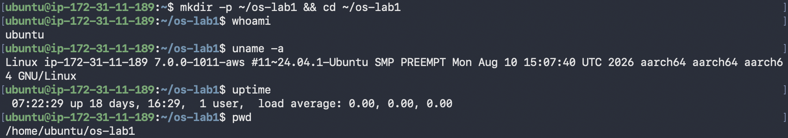
*Figure 1.1 – User, kernel, uptime and current directory*

- `whoami` → `ubuntu`, a normal user, not root.
- `uname -a` → kernel `7.0.0-1011-aws` built for Ubuntu 24.04 (`#11~24.04.1-Ubuntu`), on `aarch64`, a 64-bit ARM CPU. The hostname `ip-172-31-11-189` is the private AWS address of the machine.
- `uptime` → up 18 days, 1 user logged in, load average `0.00`, so the machine was almost idle.
- `pwd` → `/home/ubuntu/os-lab1`.

```bash
ls -la ; ls -la ~
```


*Figure 1.2 – `ls -la` in the lab folder and in my home directory*

`-l` gives the long format and `-a` also shows hidden names (the ones starting with `.`). Each line reads as: type and permissions, link count, owner, group, size in bytes, modification time, name. A few things stood out:

- `demo` was already there from an earlier try on 28 September, which explains the error in Part 2.
- `..` of my home is `/home`, owned by `root`. Everything inside my home is owned by `ubuntu`.
- `.ssh` and `.cache` are `drwx------`, so only I can enter them. `.bashrc` and `.profile` are `-rw-r--r--`, readable by everyone.

```bash
cd /etc && ls | head
cd ~/os-lab1/
```

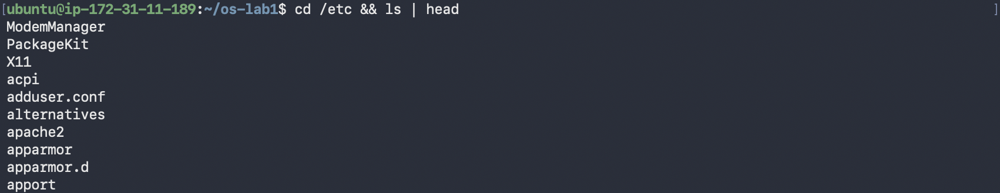
*Figure 1.3 – The first entries in /etc*

`/etc` holds system-wide configuration: `adduser.conf`, `apache2`, `apparmor`, `alternatives` and so on. `head` kept only the first 10 lines of the listing.

## Part 2. Files and permissions

My first attempts had a few mistakes, and the errors turned out to be useful:

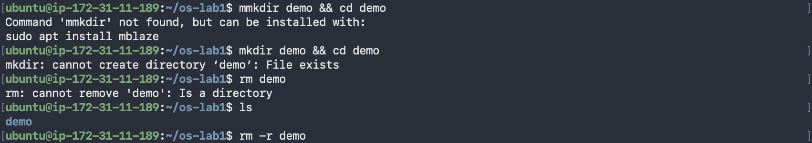
*Figure 2.1 – A typo, a directory that already exists, and rm on a directory*

- `mmkdir` → `Command 'mmkdir' not found, but can be installed with: sudo apt install mblaze`. Ubuntu's command-not-found helper searches its package index for a program with that name.
- `mkdir demo` → `File exists`, the `demo` left over from 28 September.
- `rm demo` → `Is a directory`. Plain `rm` only removes files, `rm -r` removes a directory and everything inside it.

Then the real sequence:

```bash
mkdir demo && cd demo
echo "hello operating systems" > note.txt
cp note.txt copy.txt
mv copy.txt renamed.txt
ls -l ; cat renamed.txt
rm renamed.txt ; ls -l note.txt
```

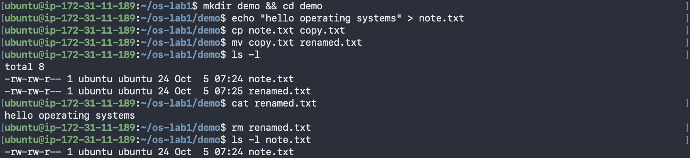
*Figure 2.2 – Creating, copying, renaming and deleting a file*

Both files are 24 bytes: 23 characters of `hello operating systems` plus the newline `echo` adds. `renamed.txt` has a later time (07:25) than `note.txt` (07:24), because `cp` creates a *new* file at the moment of copying, while `mv` only gives the existing file a new name and keeps its time.

```bash
chmod 600 note.txt ; ls -l note.txt
chmod 644 note.txt ; ls -l note.txt
```

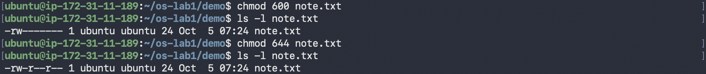
*Figure 2.3 – Changing permissions with chmod*

| Mode | `ls -l` | Owner | Group | Others |
|---|---|---|---|---|
| (new file) | `-rw-rw-r--` | read, write | read, write | read |
| `600` | `-rw-------` | read, write | none | none |
| `644` | `-rw-r--r--` | read, write | read | read |

Each digit is the sum of read (4), write (2) and execute (1) for owner, group and others. A new file starts as `-rw-rw-r--` (664) because my umask is `0002` (seen later in `/proc/<pid>/status`, Figure 3.3), which only takes away write for others.

## Part 3. Processes

```bash
ps aux | head
top
```

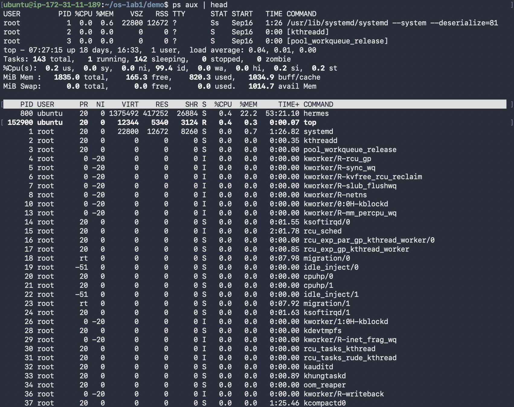
*Figure 3.1 – ps aux and top*

- PID 1 is `systemd`, the first process the kernel starts, and every other user process descends from it. PID 2 is `[kthreadd]`. Names in square brackets are kernel threads, which have no program file and use 0 memory in the `VSZ`/`RSS` columns.
- `top` shows the whole system live: **143** tasks, 1 running, 142 sleeping, 0 zombies, CPU 99.4% idle, 1835 MiB of RAM and no swap. The biggest process is `hermes` (PID 800) at 22.2% of memory. Most of the list is kernel workers (`kworker`, `ksoftirqd`, `migration`, `rcu_*`), one set per CPU.

```bash
sleep 300 &
jobs
ps -ef | grep sleep
kill 152903
jobs
```

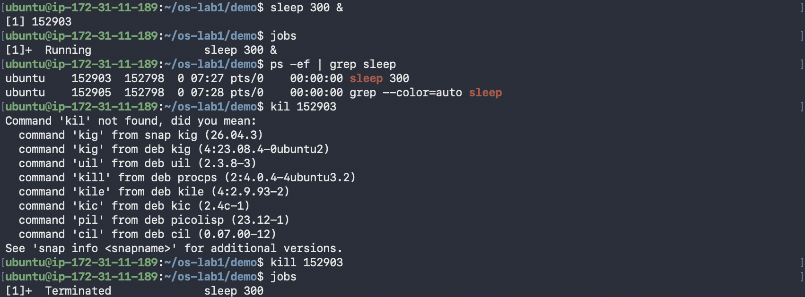
*Figure 3.2 – Running sleep in the background and stopping it*

`&` started `sleep` in the background and the shell printed the job number and PID: `[1] 152903`. `jobs` showed it as `Running`. In `ps -ef` its parent PID (PPID) is `152798`, my bash shell. `grep` also shows up because it was running at the same moment and its own command line contains "sleep". After a typo (`kil`, which again got package suggestions) `kill 152903` sent the default signal, SIGTERM, and `jobs` reported `Terminated`.

```bash
sleep 300 &
PID=$!
ls /proc/$PID/
cat /proc/$PID/status | head -20
kill $PID ; jobs
```

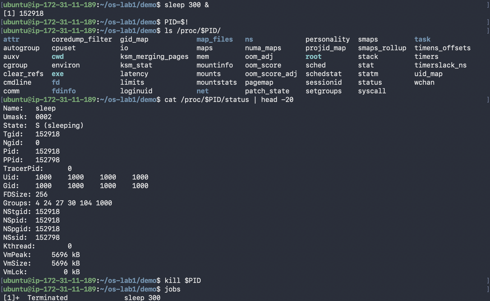
*Figure 3.3 – The process seen through /proc/PID*

`$!` holds the PID of the last background job, so I didn't have to copy it by hand. `/proc/152918/` is not a real folder on disk: the kernel generates it for that process, with entries such as `cmdline`, `cwd`, `exe`, `fd`, `environ`, `maps` and `status`. From `status`:

- `Name: sleep`, `State: S (sleeping)`, it's waiting for its timer
- `Pid: 152918`, `PPid: 152798`, same parent shell as before
- `Uid: 1000`, `Groups: 4 24 27 30 104 1000`, it runs with my identity
- `Umask: 0002`, inherited from the shell
- `VmSize: 5696 kB` of virtual memory

## Part 4. Memory, disks and devices

```bash
free -h
cat /proc/meminfo | head -6
sleep 300 & PID=$!
grep VmRSS /proc/$PID/status
kill $PID
```

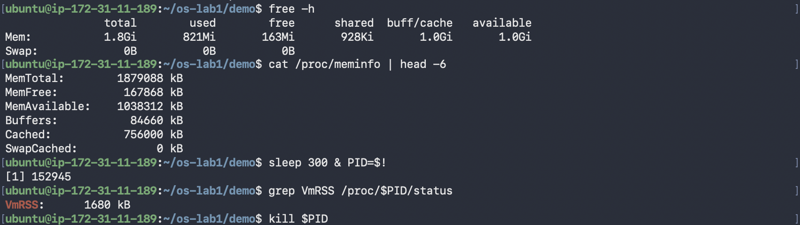
*Figure 4.1 – Memory: free, /proc/meminfo, and one process*

`free -h` reports 1.8 GiB total, 821 MiB used, 163 MiB free, 1.0 GiB of buffers/cache and 1.0 GiB available, with no swap. These numbers come straight from `/proc/meminfo`: `MemFree: 167868 kB` ≈ 163 MiB and `MemAvailable: 1038312 kB` ≈ 1.0 GiB. "Free" is low only because Linux uses spare RAM as a file cache (`Cached: 756000 kB`), and that cache is given back when programs need it, which is why "available" is much bigger than "free".

The `sleep` process had `VmRSS: 1680 kB` actually in RAM, out of the 5696 kB of virtual memory it has mapped. Shared libraries and pages it never touched don't count toward RSS.

```bash
df -h ; lsblk ; du -sh ~/os-lab1
```

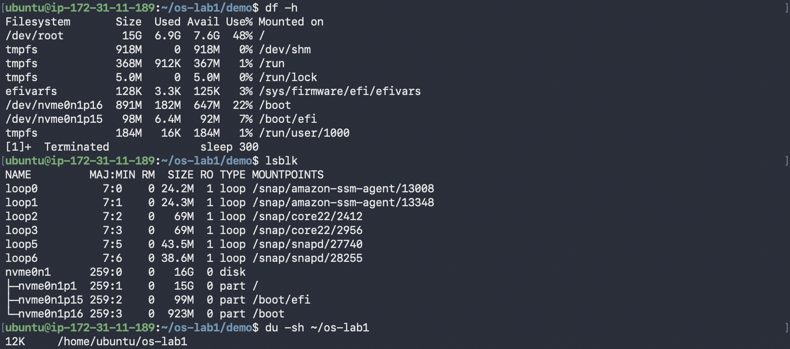
*Figure 4.2 – File systems, block devices and folder size*

- `lsblk` shows one 16 GB NVMe disk, `nvme0n1`, split into `p1` (15G, mounted on `/`), `p15` (99M, `/boot/efi`) and `p16` (923M, `/boot`). The `loop0`–`loop6` devices are snap packages, each a file-system image mounted read-only (`RO 1`).
- `df -h`: the root file system has 15G, 6.9G used, 7.6G free (48%). The `tmpfs` lines (`/dev/shm`, `/run`, `/run/lock`) live in RAM, not on the disk.
- `du -sh ~/os-lab1` → `12K`: three 4 KiB blocks for the two directories and `note.txt`. A 24-byte file still takes a whole block.

```bash
ls -l /dev | head
mount | head
```

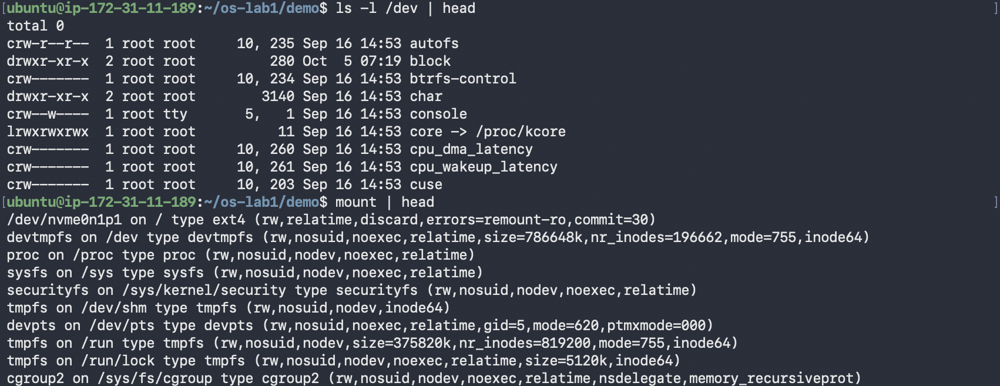
*Figure 4.3 – Device files and mounted file systems*

In `/dev` the first letter of the mode is the file type: `c` for a character device, `d` for a directory and `l` for a symbolic link (`core -> /proc/kcore`). Instead of a size, device files show two numbers, major and minor (`console` is `5, 1`), which tell the kernel which driver handles them. So the terminal is just a file, `/dev/console`, owned by `root:tty`.

`mount` shows that `/` is an `ext4` file system on `/dev/nvme0n1p1`, while `/proc` (`proc`), `/sys` (`sysfs`), `/dev` (`devtmpfs`) and `/run` (`tmpfs`) are virtual file systems that the kernel creates in memory. That is why `/proc/$PID/status` and `/proc/meminfo` could be read with plain `cat` earlier.

## Wrap-up

In this first lab I got to know the machine I'll use for the course: an Ubuntu 24.04 ARM server on AWS with a 7.0 kernel, 1.8 GiB of RAM and a 16 GB NVMe disk. I practised moving around the tree and reading `ls -l`, created, copied, renamed and deleted files, and changed their permissions with `chmod` (600 and 644), which also explained why new files start as 664 with umask `0002`. On the process side, `ps` and `top` showed that most of the 143 tasks are kernel threads under `systemd` (PID 1) and `kthreadd` (PID 2), and I ran `sleep` in the background, found it with `jobs`, `ps` and `$!`, and stopped it with `kill`. The main idea I took away is that Linux exposes almost everything as files: a process is a folder in `/proc`, memory statistics are `/proc/meminfo` (which `free` just formats), and the terminal is a device file in `/dev`.
