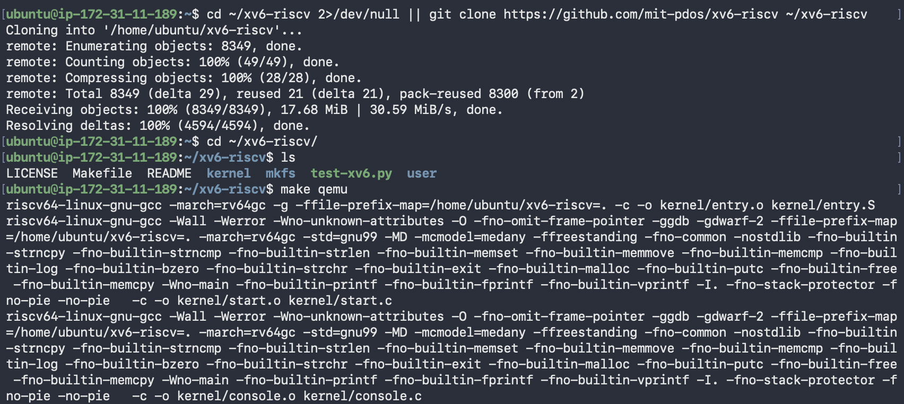
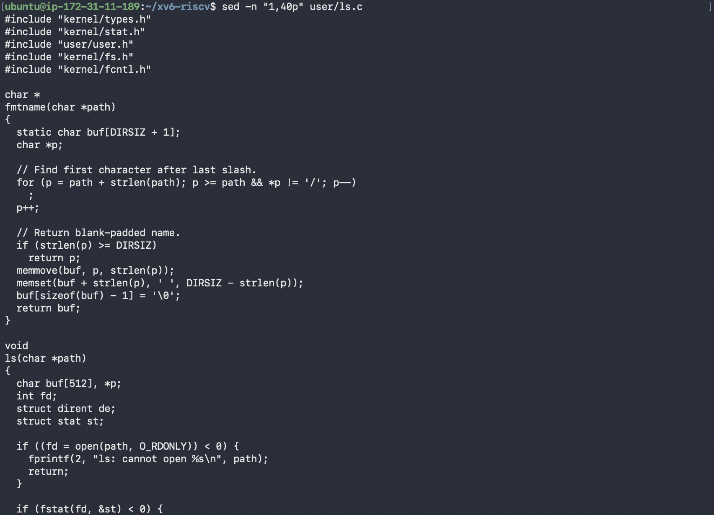
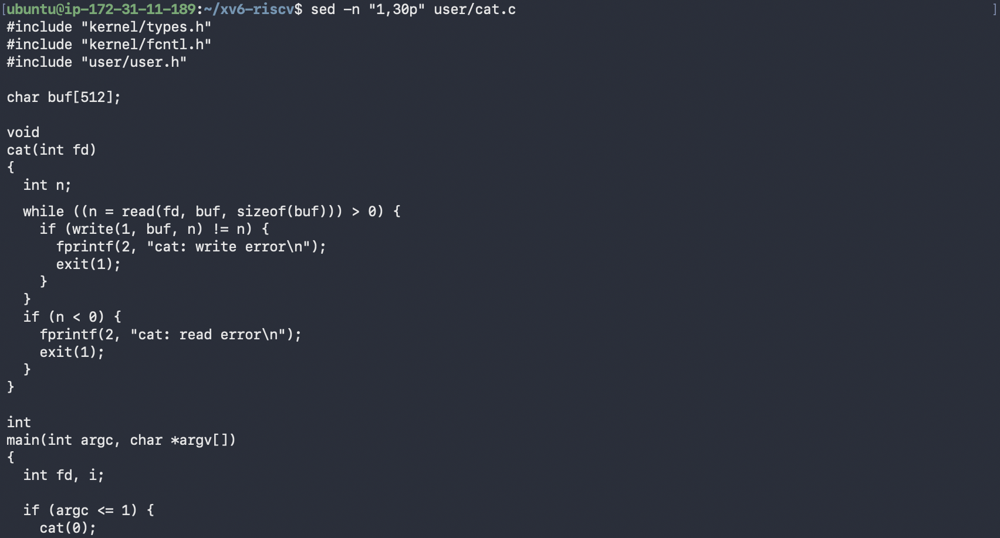
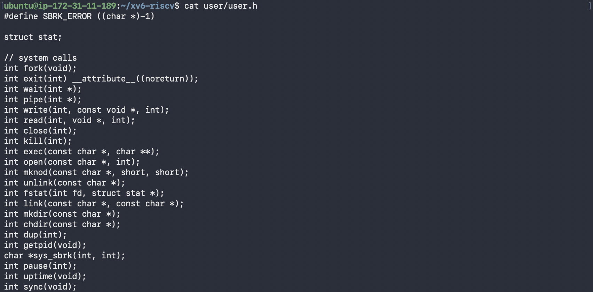
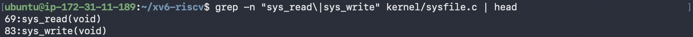
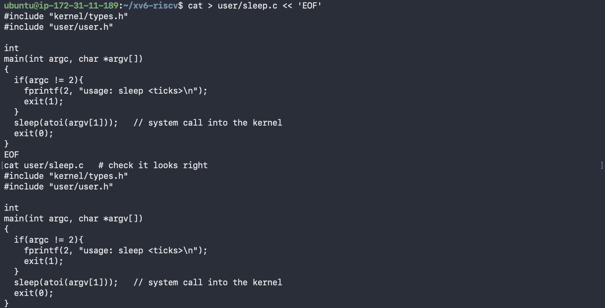
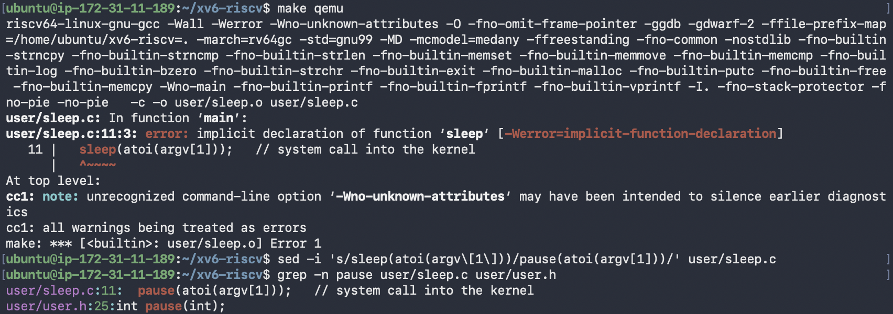

# Lab 2 · Meet the OS You Will Build

**Nichita Rusnac, FAF-242** · Technical University of Moldova, FCIM · Operating Systems · Laboratory work no. 2

The formatted report (title page, contents, figures) is [`Lab2_NichitaRusnac_FAF-242.docx`](Lab2_NichitaRusnac_FAF-242.docx).

All screenshots below come from my own session, in the order I ran the commands. Linux commands ran in bash on my Ubuntu 24.04 ARM machine on AWS, connected over SSH. xv6 commands ran at the xv6 `$` prompt inside QEMU (`make qemu`). I started from a fresh clone of upstream `mit-pdos/xv6-riscv`. The program I wrote (`sleep.c`) is next to this note in the `Lab2/` folder.

## Purpose of the work

- build the xv6 kernel with a RISC-V cross-compiler and boot it in QEMU
- use xv6 as a small Unix: run its programs, a pipe, and its own test suite
- read the source of a few user programs and find where a system call is implemented in the kernel
- write a first xv6 program (`sleep`), add it to the build, and run it inside xv6

## Part 1. Build it and boot it

```bash
cd ~/xv6-riscv 2>/dev/null || git clone https://github.com/mit-pdos/xv6-riscv ~/xv6-riscv
cd ~/xv6-riscv && ls
make qemu
```


*Figure 1.1 – Cloning xv6-riscv and starting the build*

Every file is compiled with `riscv64-linux-gnu-gcc -march=rv64gc`. This is a cross-compiler: it runs on the VM but produces machine code for a RISC-V CPU. QEMU then emulates a RISC-V machine and boots the kernel that was just built.


*Figure 1.2 – xv6 boots, starts the shell, and `ls` lists the root directory*

The lines `hart 2 starting` and `hart 1 starting` are the extra CPU cores coming online. "Hart" is the RISC-V term for a hardware thread, and QEMU is started with `-smp 3`, so there are three of them. After that `init` launches the shell and the `$` prompt appears.

## Part 2. Use xv6 as the Unix it is

```text
$ cat README
$ echo hello xv6
$ ls | grep c
$ wc README
$ usertests -q
```


*Figure 2.1 – Start of `cat README` (the rest of the file is cut)*


*Figure 2.2 – `echo`, the pipe `ls | grep c`, `wc README`, a mistyped `usertest`, then `usertests -q`*


*Figure 2.3 – End of `usertests -q` with `ALL TESTS PASSED`, then QEMU closed with Ctrl-A, X*

**1. Three programs xv6 ships with**

`ls`, `cat` and `grep`. It also includes `echo`, `wc`, `mkdir`, `rm`, `kill`, `sh` and test programs such as `usertests`.

**2. Which two OS features must exist for a pipe to work?**

- **Processes.** The shell uses `fork()` to create two processes and `exec()` to load `ls` and `grep` into them, so both run at the same time.
- **Inter-process communication.** `pipe()` gives a kernel buffer with a read end and a write end (two file descriptors). The shell attaches the output of `ls` to the write end and the input of `grep` to the read end, so the data passes from one process to the other through the kernel.

**3. xv6 shell vs the Linux shell from Lab 1**

The core is the same: running programs, pipes, `<` and `>` redirection, `&` and `;`. Everything else is missing. There is no history, no tab completion, no variables and no wildcards. Error messages are minimal too. My typo `usertest` only produced `exec usertest failed` (Figure 2.2), where Linux would say "command not found" and suggest packages, like it did for `mmkdir` in Lab 1.

**Interesting output**

xv6's `ls` prints the name, type, inode number and size of each entry. Type `1` is a directory, `2` a regular file and `3` a device, so `console 3 23 0` is the terminal exposed as a file, the same idea as `/dev/console` in Lab 1. `wc README` returned `48 336 2441` (lines, words, bytes), and 2441 is exactly the size `ls` shows for README. `usertests -q` ended with `ALL TESTS PASSED`, which confirms the kernel I built works.

## Part 3. Read the source

After quitting QEMU I read some of the source on the VM.

```bash
sed -n "1,40p" user/ls.c
sed -n "1,30p" user/cat.c
cat user/user.h
grep -n "sys_read\|sys_write" kernel/sysfile.c | head
```


*Figure 3.1 – The first 40 lines of user/ls.c*


*Figure 3.2 – The first 30 lines of user/cat.c*


*Figure 3.3 – The system call declarations in user/user.h*


*Figure 3.4 – Locating sys_read and sys_write in kernel/sysfile.c*

**1. Which system calls does `user/cat.c` use, and what does each ask the kernel?**

- `read(fd, buf, sizeof(buf))` asks the kernel to copy up to 512 bytes from an open file into `buf`. It returns the number of bytes read, or `0` at end of file.
- `write(1, buf, n)` asks the kernel to send `n` bytes to file descriptor 1, the standard output (the console).
- `exit(1)` asks the kernel to terminate the process and pass the status to its parent.
- `open()` and `close()` appear further down in `main`, to open each file given on the command line and release it afterwards.

`fprintf(2, ...)` is not a system call. It is a library function from `printf.c` that eventually calls `write()` on fd 2 (standard error).

**2. Where is `sys_read` implemented?**

In `kernel/sysfile.c` at line 69, with `sys_write` at line 83 (Figure 3.4).

**3. Difference between `kernel/` and `user/`**

`kernel/` is the operating system itself. It runs in privileged (supervisor) mode with full access to memory and devices. `user/` contains ordinary programs that run in unprivileged user mode, and the only way they can do anything outside their own memory is to ask the kernel through the system calls declared in `user/user.h`.

**Interesting output**

Figure 3.3 shows that the entire interface between programs and the kernel is 22 system calls, while Linux has several hundred. It also shows that this version has no `sleep()` declaration, only `pause(int)`, which turned out to matter in Part 4.

## Part 4. My first xv6 program

My first attempts to create `user/sleep.c` with a one-line `echo` failed, because bash treated `<ticks>` inside the string as an input redirection (`-bash: ticks: No such file or directory`). I switched to a heredoc (`cat > user/sleep.c << 'EOF'`) with the code from the lab sheet.


*Figure 4.1 – Writing user/sleep.c with a heredoc and printing it back*

Next I opened the `Makefile` in vim and added one line to `UPROGS`, indented with a TAB like the other entries:

```make
UPROGS=\
	$U/_cat\
	$U/_echo\
	$U/_sleep\
	$U/_forktest\
	...
```

The first build failed with `implicit declaration of function 'sleep'`. In current upstream xv6 the sleep system call has been renamed to `pause()` (`user/user.h` line 25, implemented as `sys_pause` in `kernel/sysproc.c`). It does the same thing the lab describes, waiting for a number of clock ticks, so I replaced the call with `sed` and checked the result with `grep`. The program is still called `sleep`.

```bash
sed -i 's/sleep(atoi(argv\[1\]))/pause(atoi(argv[1]))/' user/sleep.c
grep -n pause user/sleep.c user/user.h
```


*Figure 4.2 – The build error for sleep() and the switch to pause()*

Final `user/sleep.c`:

```c
#include "kernel/types.h"
#include "user/user.h"

int
main(int argc, char *argv[])
{
  if(argc != 2){
    fprintf(2, "usage: sleep <ticks>\n");
    exit(1);
  }
  pause(atoi(argv[1]));   // system call into the kernel
  exit(0);
}
```

Then I rebuilt and tested it inside xv6:

```text
make qemu
$ sleep 10
$ sleep
usage: sleep <ticks>
```


*Figure 4.3 – A successful rebuild, then `sleep 10` and `sleep` with no argument inside xv6*

The `mkfs` line now includes `user/_sleep`, so the program was packed into the xv6 disk image. Inside xv6, `sleep 10` paused before returning to the prompt. One tick is roughly 0.1 s in QEMU, so that is about one second. Running `sleep` without an argument printed `usage: sleep <ticks>`, so the argument check works as well.

## Wrap-up

I built xv6 from source with a RISC-V cross-compiler and booted it in QEMU on three harts. Inside it, the basics of Unix were all there: `ls`, `cat`, `echo`, `wc`, a working pipe, and a kernel that passed the full `usertests` suite. Reading the source showed how thin the layer between programs and the kernel is: `cat` is a loop of `read()` and `write()`, `user/user.h` lists only 22 system calls, and each one has a `sys_*` implementation in `kernel/` that runs in privileged mode. Writing `sleep` taught me the whole path of adding a program (source in `user/`, a TAB-indented line in `UPROGS`, `mkfs` packing it into `fs.img`) and that the current xv6 renamed the `sleep` system call to `pause()`, which the compiler caught as an implicit declaration.
