# Lab 3 · The Command Line: Shell, Pipes and Text Filters

**Nichita Rusnac, FAF-242** · Technical University of Moldova, FCIM · Operating Systems · Laboratory work no. 3

The formatted report (title page, contents, figures) is [`Lab3_NichitaRusnac_FAF-242.docx`](Lab3_NichitaRusnac_FAF-242.docx).

All screenshots below come from my own terminal session, in the order I ran the commands. I did the lab on my Ubuntu 24.04 ARM (`aarch64`) machine on AWS, connected over SSH. The files I handed in (`oneliners.sh`, `report.sh`) are next to this note in the `Lab3/` folder.

## Purpose of the work

- learn to move fast in bash: Tab completion, history search, finding help without a browser
- understand what the shell does to a command line *before* the program runs (globbing, quoting, expansions)
- control where output goes with redirection, chain commands with `;` `&&` `||`, run and stop background jobs
- answer real questions about a data file with one line of small filters joined by pipes
- turn those one-liners into a small script with argument checking, error handling and exit codes

## Before you start

The course setup script was already run on this machine, so I only ran the check:


*Figure 0.1 – The course setup check passes (tools, RISC-V compiler, QEMU 8.2, xv6 boots)*

Then I generated the data set for Part 4 exactly as given in the lab:

```bash
mkdir -p ~/os-lab3 && cd ~/os-lab3
for i in $(seq 1 500); do
  echo "2026-10-05 10:$(printf %02d $((i % 60))) user$((i % 7)) $([ $((i % 5)) -eq 0 ] && echo FAIL || echo OK) /page$((i % 4))"
done > access.log
head -3 access.log ; wc -l access.log
```


*Figure 0.2 – Generating access.log; the check prints `500 access.log`*

The check passed: `500 access.log`. Every line has the format `date time user result page`.

## Part 1. Move fast, find help

### Tab completion

I typed `ls /usr/sh` and pressed Tab, then `cd /et` and pressed Tab once.

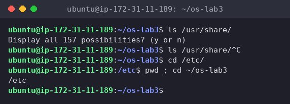
*Figure 1.1 – Tab completion*

- `ls /usr/sh` + **Tab**: only one entry in `/usr` starts with `sh` (`share`), so bash completed the whole name and added the slash: `ls /usr/share/`. The second Tab just rang the bell, because now the line ends in a directory with many possible entries. On a third Tab bash asked `Display all 157 possibilities? (y or n)` instead of flooding the screen. I answered `n`.
- `cd /et` + **Tab** (once): `/etc` is the only match, so one Tab was enough to get `cd /etc/`. After Enter, `pwd` confirmed `/etc`.

So one Tab completes when the match is unique, and a second Tab lists the choices when there are several.

### Built-in or external, and where the shell looks

```bash
type cd ; type ls ; type echo ; which ls
```

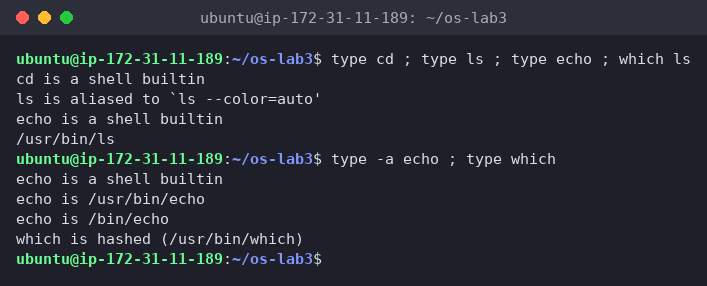
*Figure 1.2 – Output of type and which*

- `cd is a shell builtin`
- `ls is aliased to 'ls --color=auto'`. Ubuntu's `.bashrc` defines an alias, and behind it is the external program `/usr/bin/ls` (from `which ls`)
- `echo is a shell builtin`. With `type -a echo` I saw that there is *also* an external `/usr/bin/echo`, but bash finds its built-in first

```bash
echo $PATH
echo $PATH | tr ':' '\n'      # one directory per line
```

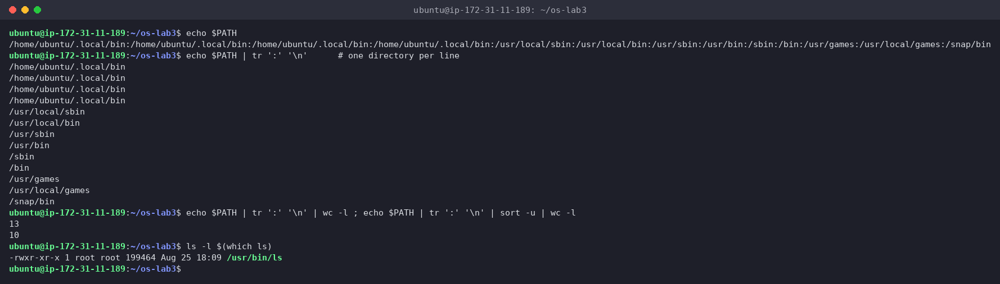
*Figure 1.3 – The directories in PATH*

`tr ':' '\n'` swaps every colon for a newline, so each directory gets its own line. `wc -l` counted **13** entries but only **10 unique** ones: `/home/ubuntu/.local/bin` is there 4 times. Both my `~/.profile` and `~/.bashrc` prepend it, and each nested login shell (my SSH session → tmux → bash) adds it again. It does no harm, since the shell stops at the first match, but it's a good example of how PATH gets built by start-up files. `ls` lives in `/usr/bin` (`/usr/bin/ls`, 8th entry).

```bash
nosuchprog ; echo "exit code: $?"
```

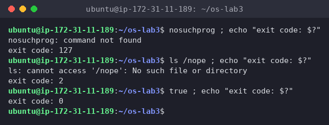
*Figure 1.4 – Exit code of a missing command*

`nosuchprog: command not found`, `exit code: 127`. For comparison, `ls /nope` (program found, but it failed) gives `2`, and `true` gives `0`.

### History search with Ctrl+R

I ran three commands (`date`, `hostname`, `uptime`), then pressed **Ctrl+R** and typed `dat`:


*Figure 1.5 – Ctrl+R reverse search while typing `dat`*


*Figure 1.6 – After Enter, the found command `date` runs again*

The prompt changed to `(reverse-i-search)`dat': date`, and bash searched backwards through history as I typed, highlighting the match. Enter ran `date` again immediately (new time `01:20:06`), without me typing it.

### Help without a browser

I opened `man ls`, searched with `/sort` (`n` for the next hit), and then searched for the line that starts with `-t`:


*Figure 1.7 – `man ls`: the `-t` option*


*Figure 1.8 – `ls --help`, `man -k "list directory"` and `help cd`*

- `ls --help` is a short summary built into the program itself
- `man -k "list directory"` searches man page descriptions and found `dir`, `ls`, `ntfsls` and `vdir`
- `help cd` works where `man cd` wouldn't, because `cd` is a bash built-in, so its documentation is inside bash

**1. Which of cd, ls, echo are built-ins, and why MUST cd be one?**

`cd` and `echo` are built-ins. `ls` is an external program (`/usr/bin/ls`, behind an alias). `cd` *must* be a built-in because the current directory is a property of each process. An external program runs in a new child process (fork + exec), so a `/usr/bin/cd` would change the child's directory and then exit, and my shell would stay where it was. Only the shell process itself can call `chdir()` on itself. (`echo` doesn't have to be a built-in, the external `/usr/bin/echo` exists too, it's just built in for speed.)

**2. How many directories are in your PATH, and in which one is ls?**

13 entries, 10 different directories (`~/.local/bin` is repeated 4 times). `ls` is in `/usr/bin`.

**3. What exit code does a command that is not found return?**

`127`. (`126` would mean found but not executable, and a program that runs and fails returns its own code, like `2` for `ls /nope`.)

**4. Which option of ls sorts by modification time?**

`-t`: "sort by time, newest first" (Figure 1.7). Usually combined as `ls -lt`, or `ls -ltr` for oldest first.

**Interesting output**

The duplicated `~/.local/bin` in PATH. I'd never have noticed it with the long `echo $PATH` line, but one entry per line with `tr` made it obvious. Also, `type -a echo` showing three `echo`s (builtin, `/usr/bin/echo`, `/bin/echo`) shows that the order of lookup matters: aliases → built-ins → PATH from left to right. On Ubuntu `/bin` is a symlink to `/usr/bin`, which is why the same file appears twice.

## Part 2. What the shell does to your line

```bash
mkdir -p ~/os-lab3/play && cd ~/os-lab3/play
touch a.c b.c file1.txt file2.txt notes.txt "alfa beta.txt"
ls
```

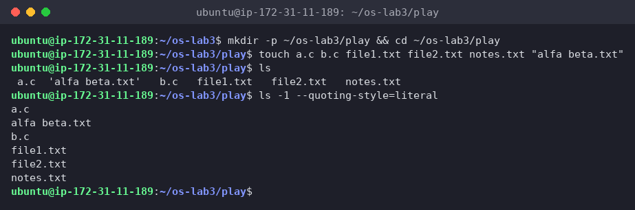
*Figure 2.1 – Files created in the play directory*

I wrote all my predictions down (in `~/os-lab3/predictions.md`, at 01:21) **before** running anything, then ran each line:

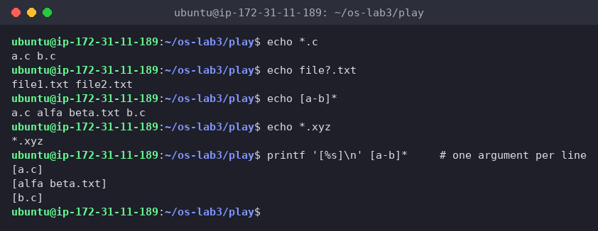
*Figure 2.2 – Globbing results*

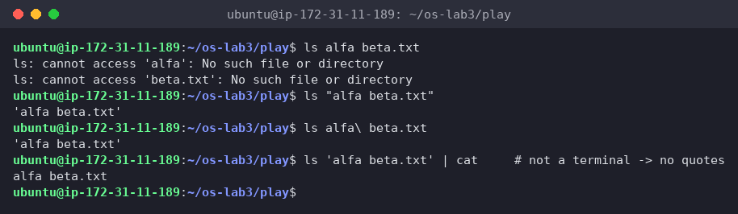
*Figure 2.3 – The ls error on a name with a space, and the fix*

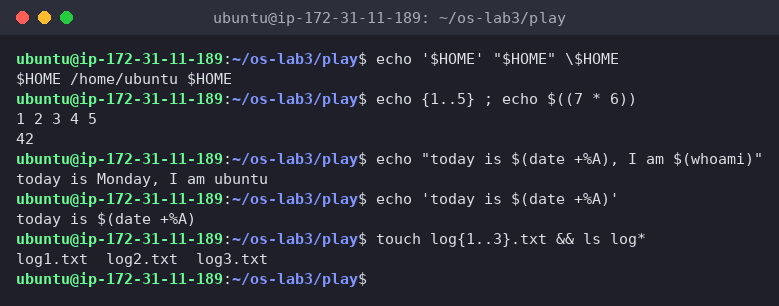
*Figure 2.4 – Single quotes, double quotes and backslash (plus brace, arithmetic and command substitution)*

| Command | My prediction | Real output | Explanation (if different) |
|---|---|---|---|
| `echo *.c` | `a.c b.c` | `a.c b.c` | ✓ |
| `echo file?.txt` | `file1.txt file2.txt` | `file1.txt file2.txt` | ✓ `?` = exactly one character |
| `echo [a-b]*` | `a.c alfa beta.txt b.c` | `a.c alfa beta.txt b.c` | ✓ looks like 4 words, but it's 3 arguments (checked with `printf '[%s]\n' [a-b]*`) |
| `echo *.xyz` | `*.xyz` | `*.xyz` | ✓ no match, so bash leaves the pattern as it is |
| `ls alfa beta.txt` | 2 errors, for `alfa` and `beta.txt` | `cannot access 'alfa'` / `cannot access 'beta.txt'` | ✓ |
| `ls "alfa beta.txt"` | `alfa beta.txt` | `'alfa beta.txt'` | ✗ ls itself added the single quotes, see the note below |
| `echo '$HOME' "$HOME" \$HOME` | `$HOME /home/ubuntu $HOME` | `$HOME /home/ubuntu $HOME` | ✓ |
| `echo {1..5} ; echo $((7 * 6))` | `1 2 3 4 5` / `42` | `1 2 3 4 5` / `42` | ✓ |
| `echo "today is $(date +%A), I am $(whoami)"` | `today is Monday, I am ubuntu` | `today is Monday, I am ubuntu` | ✓ |
| `touch log{1..3}.txt && ls log*` | `log1.txt log2.txt log3.txt` | `log1.txt  log2.txt  log3.txt` | ✓ |

**1. Prediction vs real output**

See the table. The only mismatch was `ls "alfa beta.txt"`, where I expected the bare name and got it in quotes.

**2. echo knows nothing about files, yet `echo *.c` printed file names. Who produced them?**

The **shell**. Before running `echo`, bash expands the glob `*.c`, reads the directory, finds `a.c` and `b.c`, and replaces the pattern with them. `echo` just receives the arguments `a.c` and `b.c` and prints them. That's also why `echo *.xyz` printed `*.xyz`: with no match, bash passes the pattern on unchanged.

**3. Why did `ls alfa beta.txt` fail? Two ways to fix it.**

The shell splits the line into words at spaces, so `ls` got two arguments, `alfa` and `beta.txt`, and neither file exists. The fix is to stop the split so the name arrives as one argument:

- quotes: `ls "alfa beta.txt"` (or `'alfa beta.txt'`)
- escape the space: `ls alfa\ beta.txt`

(A third option is Tab completion, which inserts the backslash for you.)

**4. What is the difference between single and double quotes?**

- **Single quotes** turn off everything: `'$HOME'` stays the literal text `$HOME`, and `'$(date)'` isn't run (Figure 2.4, line 4).
- **Double quotes** keep the text as one word (no splitting, no globbing) but still allow `$VAR`, `$(command)` and `$((math))` expansions, so `"$HOME"` became `/home/ubuntu` and `"today is $(date +%A)"` ran `date`.
- **Backslash** protects just the next character: `\$HOME` → `$HOME`.

**Note: why does ls show `'alfa beta.txt'` in quotes?**

Since coreutils 8.25, when the output goes to a terminal, `ls` quotes names that contain spaces or special characters (`--quoting-style=shell-escape`), so you can see where the name starts and ends and copy-paste it straight back into a command. The quotes are not part of the name. When the output goes into a pipe (`ls 'alfa beta.txt' | cat`) or with `--quoting-style=literal`, it prints the plain name `alfa beta.txt` (Figures 2.1 and 2.3).

**Interesting output**

`echo [a-b]*` *looks* like four words, but `printf '[%s]\n' [a-b]*` showed three arguments (`[a.c]`, `[alfa beta.txt]`, `[b.c]`). File names that come out of a glob are not split again at spaces, so globbing is safe with spaces while `$var` without quotes is not.

## Part 3. Redirection, chaining and jobs

```bash
cd ~/os-lab3
ls /etc /nope > out.txt 2> err.txt
wc -l out.txt ; cat err.txt
```

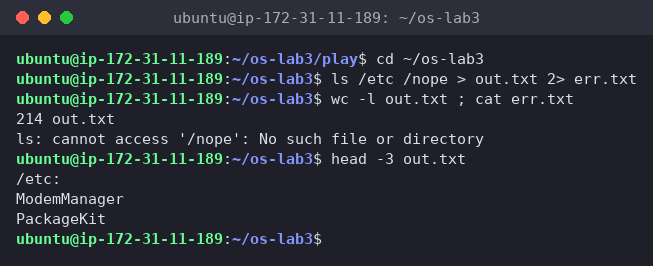
*Figure 3.1 – stdout and stderr in separate files*

Nothing appeared on the screen: the listing went into `out.txt` (214 lines, the `/etc:` header plus 213 names) and the error went into `err.txt`.

```bash
ls /etc /nope > all.txt 2>&1 ; tail -2 all.txt
ls /etc /nope 2>&1 > all.txt
```

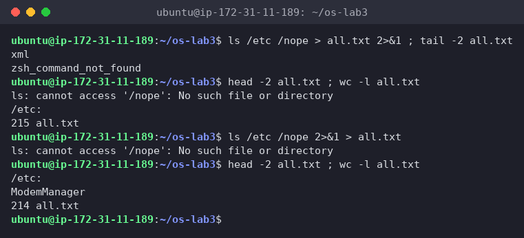
*Figure 3.2 – Comparing the order of redirections*

- `> all.txt 2>&1`: nothing on screen, and `all.txt` has 215 lines, the listing **plus** the error. `tail -2` only shows `xml` and `zsh_command_not_found`, because the error is at the **top** of the file (`head -2`): stderr is not buffered, so `ls` writes the error immediately, while the listing on stdout is buffered and written at the end.
- `2>&1 > all.txt`: the error **appeared on the screen**, and `all.txt` has only 214 lines, the listing alone.

```bash
echo first > notes.md ; echo second >> notes.md ; cat notes.md
wc -l < access.log
```

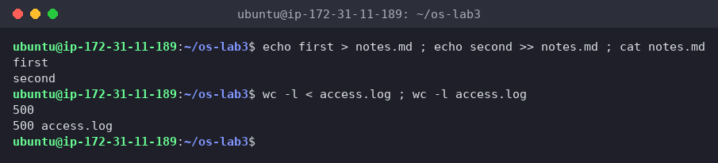
*Figure 3.3 – Overwrite vs append, and stdin redirection*

`>` created/truncated `notes.md` with `first`, then `>>` appended `second`, so both lines are there.

```bash
ls /nope 2> /dev/null || echo "failed with code $?"
mkdir -p tmp && cd tmp && echo "I am in $(pwd)" ; cd ~/os-lab3
```

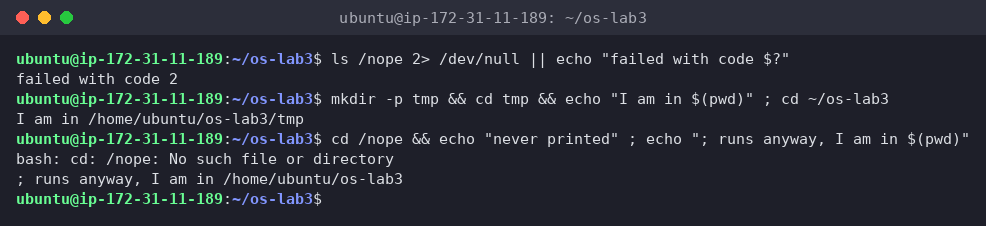
*Figure 3.4 – The ; && || operators*

- the error went to `/dev/null` (discarded), `ls` failed, so `||` ran the echo: `failed with code 2`
- `mkdir` succeeded → `&&` → `cd tmp` succeeded → `&&` → `I am in /home/ubuntu/os-lab3/tmp`, then `;` ran `cd ~/os-lab3` regardless
- I added one more line to show the difference: `cd /nope && echo "never printed" ; echo ...`. `cd` failed, so `&&` skipped the first echo, but `;` still ran the second one

```bash
sleep 100 &
jobs ; kill %1 ; jobs
```

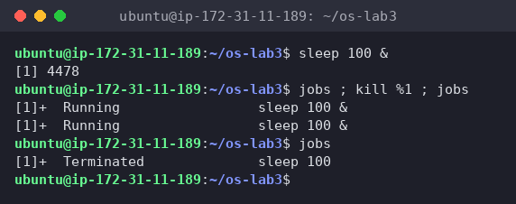
*Figure 3.5 – Running a background job and stopping it*

`sleep 100 &` printed `[1] 4478` (job number and PID) and gave me the prompt back immediately. In the same line, both `jobs` printed `Running`, even the one after `kill`. `kill` only *sends* SIGTERM and returns at once, so the second `jobs` ran before the kernel had finished the process. A moment later, the next `jobs` showed `[1]+  Terminated  sleep 100`.

**1. Which file got the error message, and which got the listing?**

`err.txt` got the error (`ls: cannot access '/nope': No such file or directory`) because `2>` redirects file descriptor 2 (stderr). `out.txt` got the listing of `/etc` because `>` redirects file descriptor 1 (stdout).

**2. Difference between `> all.txt 2>&1` and `2>&1 > all.txt`?**

Redirections are processed **left to right**, and `2>&1` means "make fd 2 a copy of *whatever fd 1 points to right now*":

- `> all.txt 2>&1`: first fd 1 → `all.txt`, then fd 2 → copy of fd 1 = `all.txt`. **Both** go to the file.
- `2>&1 > all.txt`: first fd 2 → copy of fd 1 = **the terminal**, then fd 1 → `all.txt`. fd 2 still points at the terminal, so the error shows on screen and only the listing goes into the file.

It's like copying a pointer: changing fd 1 afterwards doesn't change the earlier copy.

**3. Why does `wc -l < access.log` print only a number, while `wc -l access.log` also prints the name?**

With `< access.log` the **shell** opens the file and connects it to `wc`'s stdin. `wc` gets no file name argument and just reads anonymous data from fd 0, so it has no name to print. With `wc -l access.log`, `wc` opens the file itself, knows the name and prints it next to the count (`500` vs `500 access.log`).

**4. Each operator in one sentence**

- `;` runs the next command after the previous one finishes, whatever its result.
- `&&` runs the next command only if the previous one **succeeded** (exit code 0).
- `||` runs the next command only if the previous one **failed** (exit code not 0).

**Interesting output**

Two timing effects I didn't expect: the error landing at the *top* of `all.txt` (unbuffered stderr vs buffered stdout), and `jobs` still saying `Running` right after `kill`. Both show that the shell and the processes run independently, and output order isn't always the order you typed things in.

## Part 4. Answer questions with one-liners

Each line of `access.log` is `date time user result page`, so with `cut -d' '` the fields are: `-f2` time, `-f3` user, `-f4` OK/FAIL, `-f5` page.

**Q1. How many requests failed?**

```bash
grep -c FAIL access.log
```

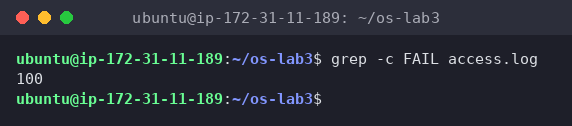
*Figure 4.1 – Number of failed requests*

**100** requests failed. `grep -c` counts matching lines. (It makes sense: a line fails when `i % 5 == 0`, which is every 5th of 500.)

**Q2. How many different pages were requested, and which?**

```bash
cut -d' ' -f5 access.log | sort -u | nl
```

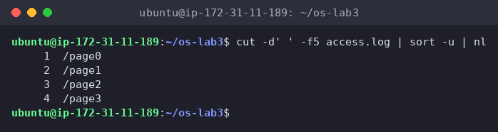
*Figure 4.2 – The different pages requested*

**4** pages: `/page0`, `/page1`, `/page2`, `/page3`. `sort -u` keeps one copy of each, and `nl` numbers them, so the last number is the count.

**Q3. How many requests did each page get?**

```bash
cut -d' ' -f5 access.log | sort | uniq -c
```

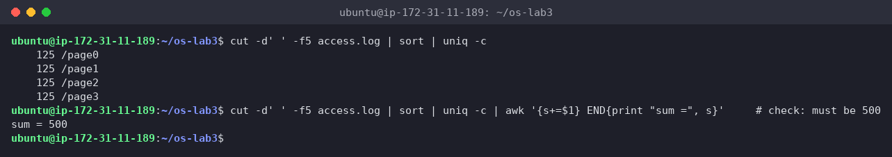
*Figure 4.3 – Requests per page*

Each page got **125** requests. The check `125 × 4 = 500` adds up to the log size (confirmed with a sum in the screenshot). `uniq -c` only merges *adjacent* equal lines, which is why `sort` must come first.

**Q4. Which user or users have the most failed requests, and how many?**

```bash
grep FAIL access.log | cut -d' ' -f3 | sort | uniq -c | sort -rn | awk 'NR==1{max=$1} $1==max'
```

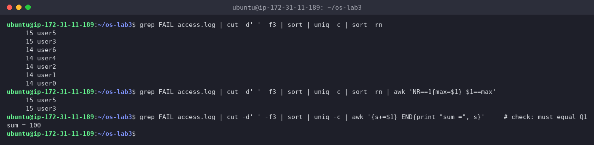
*Figure 4.4 – Users with the most failed requests*

**user3 and user5, 15 failed requests each.** It's a tie, so the usual `sort -rn | head -1` would have shown only one of them and given a wrong answer. The last `awk` step remembers the count in the first (largest) line and prints every line with that same count. Check: the per-user failures (14+14+14+15+14+15+14) add up to **100**, the same as Q1.

**Q5. How many requests did user3 make, and how many of them failed?**

```bash
echo "user3: $(grep -cw user3 access.log) requests, $(grep -w user3 access.log | grep -c FAIL) failed"
```

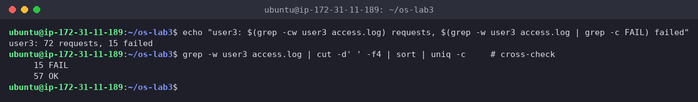
*Figure 4.5 – user3: total and failed requests*

**72 requests, 15 failed** (57 OK + 15 FAIL, cross-checked with `uniq -c`). `-w` matches whole words only, so a future `user30` wouldn't be counted as `user3`.

**Q6. Print the last 3 failed requests, showing only time and user.**

```bash
grep FAIL access.log | tail -3 | cut -d' ' -f2,3
```

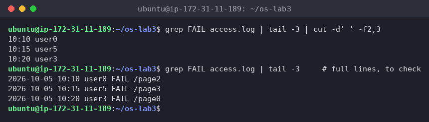
*Figure 4.6 – The last 3 failed requests (time and user)*

`10:10 user0`, `10:15 user5`, `10:20 user3`. The order of the filters matters: `tail -3` has to come *after* `grep FAIL`, otherwise it would take the last 3 lines of the whole log.

**Q7. Which login shells appear in /etc/passwd, and how many accounts use each?**

```bash
cut -d: -f7 /etc/passwd | sort | uniq -c | sort -rn
```

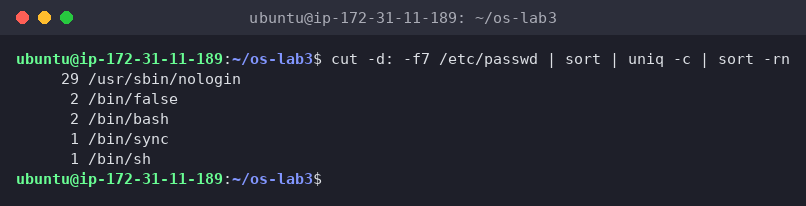
*Figure 4.7 – Login shells in /etc/passwd*

| Accounts | Shell |
|---|---|
| 29 | `/usr/sbin/nologin` |
| 2 | `/bin/false` |
| 2 | `/bin/bash` |
| 1 | `/bin/sync` |
| 1 | `/bin/sh` |

Most accounts are system/service users (`daemon`, `www-data` …) with `nologin` or `false`, so nobody can log in as them. Only `root` and my `ubuntu` user have `/bin/bash`.

**Q8. PREDICT, then explain: why do `ls /etc | wc -l` and `ls -l /etc | wc -l` differ by exactly one?**

My prediction (written down first): `ls -l` prints an extra `total <blocks>` line at the top, so it has one more line.

```bash
ls /etc | wc -l
ls -l /etc | wc -l
```

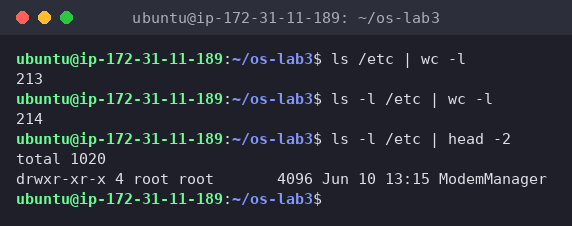
*Figure 4.8 – ls vs ls -l line count*

`213` vs `214`, and `ls -l /etc | head -2` shows the first line is `total 1020`, so my prediction was right. Both print one line per entry (when `ls` writes into a pipe it switches to one name per line, not columns), but `ls -l` adds the `total` line: the disk space used by the listed files, in 1 KiB blocks.

**Full run of oneliners.sh**

The file has each question as a comment and one command line under it. I ran it with `bash -v`, which echoes every line of the script before running it, so the questions appear next to their answers:

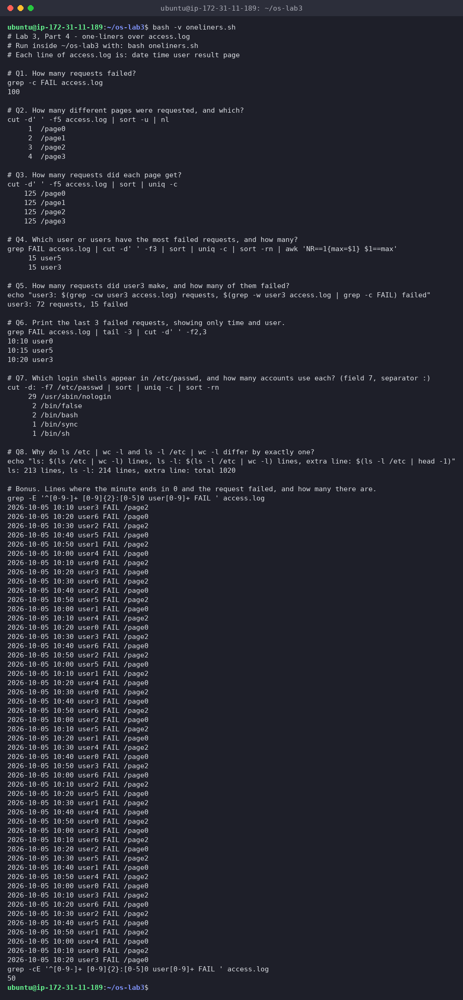
*Figure 4.9 – Full run of oneliners.sh*

Final `oneliners.sh` (also in this folder as `oneliners.sh`):

```bash
# Lab 3, Part 4 - one-liners over access.log
# Run inside ~/os-lab3 with: bash oneliners.sh
# Each line of access.log is: date time user result page

# Q1. How many requests failed?
grep -c FAIL access.log

# Q2. How many different pages were requested, and which?
cut -d' ' -f5 access.log | sort -u | nl

# Q3. How many requests did each page get?
cut -d' ' -f5 access.log | sort | uniq -c

# Q4. Which user or users have the most failed requests, and how many?
grep FAIL access.log | cut -d' ' -f3 | sort | uniq -c | sort -rn | awk 'NR==1{max=$1} $1==max'

# Q5. How many requests did user3 make, and how many of them failed?
echo "user3: $(grep -cw user3 access.log) requests, $(grep -w user3 access.log | grep -c FAIL) failed"

# Q6. Print the last 3 failed requests, showing only time and user.
grep FAIL access.log | tail -3 | cut -d' ' -f2,3

# Q7. Which login shells appear in /etc/passwd, and how many accounts use each? (field 7, separator :)
cut -d: -f7 /etc/passwd | sort | uniq -c | sort -rn

# Q8. Why do ls /etc | wc -l and ls -l /etc | wc -l differ by exactly one?
echo "ls: $(ls /etc | wc -l) lines, ls -l: $(ls -l /etc | wc -l) lines, extra line: $(ls -l /etc | head -1)"

# Bonus. Lines where the minute ends in 0 and the request failed, and how many there are.
grep -E '^[0-9-]+ [0-9]{2}:[0-5]0 user[0-9]+ FAIL ' access.log
grep -cE '^[0-9-]+ [0-9]{2}:[0-5]0 user[0-9]+ FAIL ' access.log
```

**Bonus (+1): minute ends in 0 and the request failed**

```bash
grep -E '^[0-9-]+ [0-9]{2}:[0-5]0 user[0-9]+ FAIL ' access.log
grep -cE '^[0-9-]+ [0-9]{2}:[0-5]0 user[0-9]+ FAIL ' access.log
```

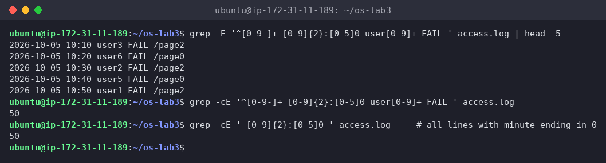
*Figure 4.10 – Bonus: failed requests at minutes 10:00, 10:10, … (grep -E)*

**50** lines. The regex is anchored to the line's structure: date, then `HH:` followed by `[0-5]0` (minutes 00, 10, …, 50), then a user, then `FAIL`. Interesting detail: counting *all* lines whose minute ends in 0 also gives 50. The minute is `i % 60`, and it ends in 0 only when `i` is a multiple of 10, which is also a multiple of 5, so every one of those requests is a FAIL.

**Interesting output**

The Q4 tie (user3 and user5 both have 15). The "count per user" pattern from the lab with `head -1` would have silently given only one name. The checks the lab suggests (Q3 sums to 500, Q4 sums to Q1) passed, which confirms the pipelines filter the right thing.

## Part 5. Your first script

I created `report.sh` from the template and completed the TODO with a loop over `user0` … `user6`:

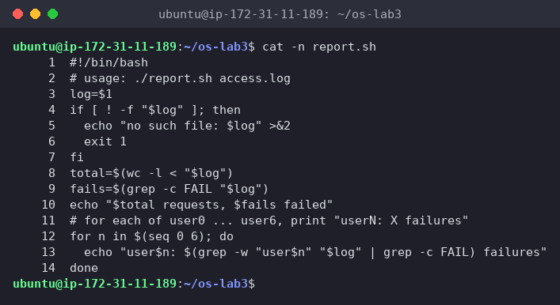
*Figure 5.1 – Contents of report.sh*

```bash
#!/bin/bash
# usage: ./report.sh access.log
log=$1
if [ ! -f "$log" ]; then
  echo "no such file: $log" >&2
  exit 1
fi
total=$(wc -l < "$log")
fails=$(grep -c FAIL "$log")
echo "$total requests, $fails failed"
# for each of user0 ... user6, print "userN: X failures"
for n in $(seq 0 6); do
  echo "user$n: $(grep -w "user$n" "$log" | grep -c FAIL) failures"
done
```

Before `chmod +x` I deliberately tried to run it, then made it executable and ran it:

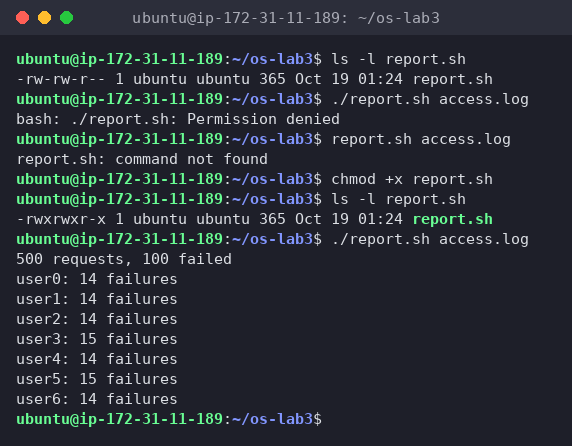
*Figure 5.2 – Running the script on access.log (before and after chmod +x)*

```bash
./report.sh nope.log ; echo "exit code: $?"
```

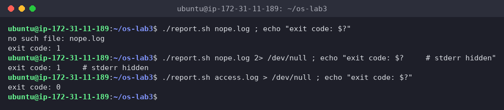
*Figure 5.3 – Error handling for a missing file*

The output matches the one-liners: `500 requests, 100 failed`, user3 and user5 with 15, the rest with 14. With a missing file it prints `no such file: nope.log` and returns `exit code: 1`. With `2> /dev/null` the message disappears but the exit code stays 1, and a successful run returns 0.

**1. What does `#!/bin/bash` do, and what happens if you run `./report.sh` before `chmod +x`?**

`#!` ("shebang") on the first line tells the **kernel**, when it `exec`s the file, which interpreter to start: it runs `/bin/bash ./report.sh access.log`, so the script works no matter which shell I'm using. Before `chmod +x` the file is `-rw-rw-r--` (no `x` bit), so the kernel refuses to execute it: `bash: ./report.sh: Permission denied` (Figure 5.2). It could still be run as `bash report.sh access.log`, because then bash is the program being executed and the script is just a file it reads.

**2. Why `./report.sh` and not just `report.sh`?**

A name without a `/` is looked up only in the PATH directories (Part 1), and `~/os-lab3` is not in PATH, so `report.sh access.log` gave `report.sh: command not found`. `./` is an explicit path ("in the current directory"), so no PATH search happens. The current directory is left out of PATH on purpose: otherwise a malicious file called `ls` in some folder would run instead of `/usr/bin/ls`.

**3. Why does the script write the error with `>&2` and end with `exit 1`?**

- `>&2` sends the message to **stderr**, not stdout. If someone runs `./report.sh x > result.txt` or pipes it into another command, the error still shows on the screen and doesn't get mixed into the data.
- `exit 1` returns a non-zero exit code, the standard way to say "failed". Callers can react to it with `&&`, `||`, `if`, or cron/CI checks. Without it the script would return 0 and look successful.

### Bonus (+1): run it with cron

I added one line to my crontab, keeping the line that was already there (my vault's auto-sync), with full paths and `>> … 2>&1`:

```cron
* * * * * /home/ubuntu/os-lab3/report.sh /home/ubuntu/os-lab3/access.log >> /home/ubuntu/os-lab3/report.log 2>&1
```

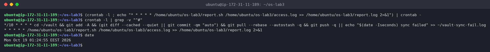
*Figure 5.4 – The crontab line added (01:24:55)*

After two minutes:

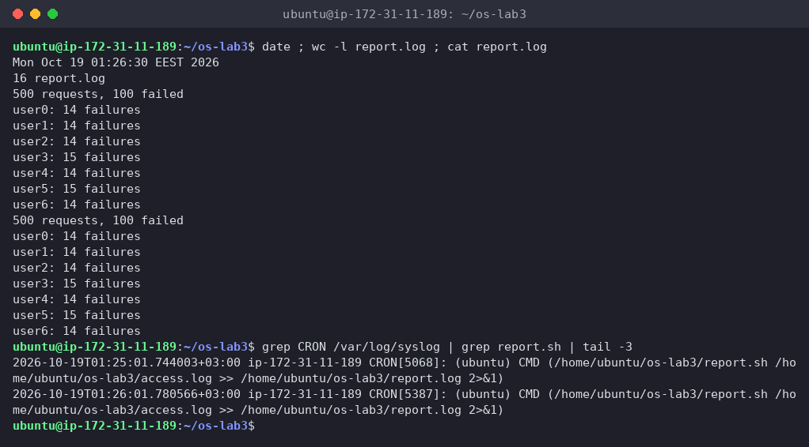
*Figure 5.5 – report.log after two cron runs, and the CRON entries in syslog*

`report.log` has 16 lines, two full reports, and `/var/log/syslog` shows `CRON[...]: (ubuntu) CMD (...)` at exactly `01:25:01` and `01:26:01`. Then I removed **only my line**. I didn't use `crontab -r`, because that would also delete the sync job:

```bash
crontab -l | grep -v "os-lab3/report.sh" | crontab -
```

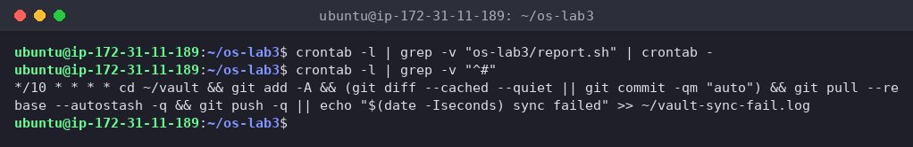
*Figure 5.6 – Crontab after removing the line (only the original job is left)*

Full paths are needed because cron runs jobs with a minimal environment (`PATH=/usr/bin:/bin`, home directory as the working directory, no terminal), so relative paths like `access.log` would point to the wrong place. `2>&1` makes sure any error also ends up in the log, since there's no screen to show it on.

## Wrap-up

This lab showed me that the shell does much more than start programs: before anything runs, bash completes, expands globs, braces, variables and `$(...)`, removes quotes and splits the line into words. The program then only gets the finished argument list. I saw this with `echo *.c`, the space in `alfa beta.txt`, and the difference between single and double quotes. Redirection and pipes are the shell connecting file descriptors 0, 1 and 2 to files or to other processes, and the order matters (`> f 2>&1` vs `2>&1 > f`). With `grep`, `cut`, `sort`, `uniq`, `wc`, `head` and `tail` joined by pipes I answered every question about the log in one line, and the sum checks caught the tie in Q4. Finally, exit codes and stderr turned those one-liners into a real script (`report.sh`) that other tools, like `&&`, `||` and cron, can rely on.
