# Lab 4 · The xv6 Shell from the Outside

**Nichita Rusnac, FAF-242** · Technical University of Moldova, FCIM · Operating Systems · Laboratory work no. 4

The formatted report (title page, contents, figures) is [`Lab4_NichitaRusnac_FAF-242.docx`](Lab4_NichitaRusnac_FAF-242.docx).

All screenshots below come from my own session, in the order I ran the commands. Linux commands ran in bash on my Ubuntu 24.04 ARM machine on AWS. xv6 commands ran at the xv6 `$` prompt inside QEMU (`make qemu`), on the revision the labs were tested on (`06aad25`). The files I handed in (`sleep.c`, `args.c`, `args_linux.c`, `Makefile`) are next to this note in the `Lab4/` folder.

## Purpose of the work

- make my `sleep` program from Lab 2 build and run on the current xv6, where `sleep()` was renamed to `pause()`
- use the xv6 shell (`user/sh.c`, ~500 lines) side by side with bash and find out by experiment what a shell *must* do and what bash adds on top
- write a program that prints its `argv` and use it to prove who expands `*` and removes quotes: the program, the kernel or the shell
- read the xv6 shell source to see how it parses and runs the five kinds of commands, and how it handles `cd`

## Before you start

```bash
bash os2026-setup.sh --check
```


*Figure 0.1 – The setup check: tools OK, QEMU 8.2, xv6 builds and boots*

Everything passed, so I didn't need to run the full install.

## Part 1. Fix sleep for the current xv6

```bash
cd ~/xv6-riscv
grep -n "pause\|sleep" user/user.h
```

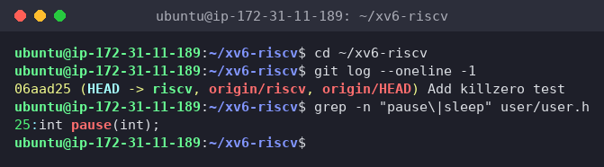
*Figure 1.1 – The grep result in user.h*

Only `25:int pause(int);` matches. My tree has no `sleep` declaration at all, so it is the post-August-2025 xv6, and the system call is `pause()`. I'd already hit this in Lab 2 (`implicit declaration of function 'sleep'`) and switched to `pause()`. For this lab I updated the comment to match the lab's version:

```c
#include "kernel/types.h"
#include "user/user.h"

int
main(int argc, char *argv[])
{
  if(argc != 2){
    fprintf(2, "usage: sleep <ticks>\n");
    exit(1);
  }
  pause(atoi(argv[1]));   // was sleep() before Aug 2025
  exit(0);
}
```

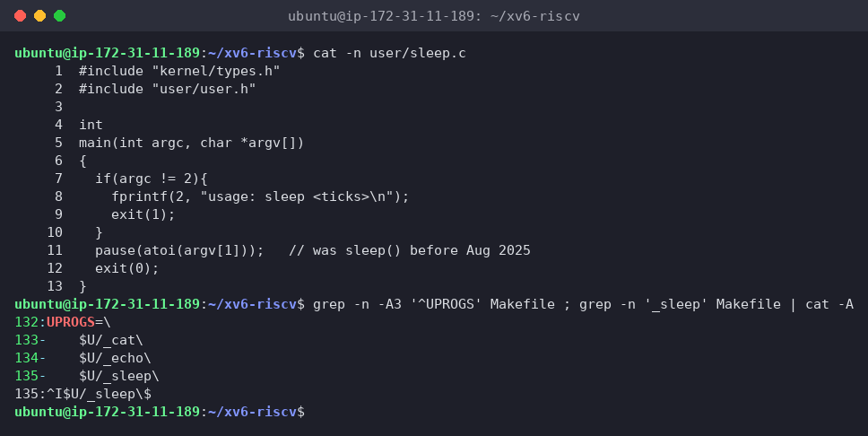
*Figure 1.2 – The updated sleep.c and its UPROGS line*

To check the Makefile I printed the UPROGS line with `cat -A`, which shows invisible characters: `^I$U/_sleep\$`. `^I` is the TAB at the start and `$` (end of line) comes right after the backslash, so nothing follows it, exactly as the Makefile reminder requires.

```text
make qemu
$ sleep 20
$ sleep
usage: sleep <ticks>
```

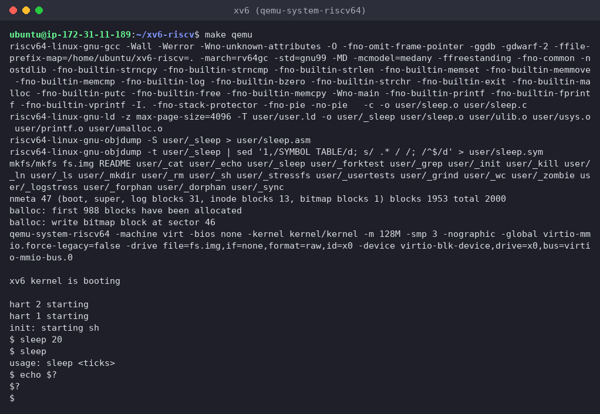
*Figure 1.3 – sleep running in xv6, with and without an argument*

`make` recompiled only `user/sleep.c` (the file I changed), relinked `_sleep`, and `mkfs` put it into `fs.img`. In xv6, `sleep 20` paused and then gave the prompt back. I timed it from outside: about **2.0 s**, so one xv6 tick is about 0.1 s (`kernel/trap.c` sets the next timer interrupt `1000000` time units ahead, with the comment *"1000000 is about a tenth of a second"*). Without an argument it printed `usage: sleep <ticks>`.

I also tried `echo $?` out of habit, and xv6 printed `$?` literally, a first hint for Part 2: the xv6 shell has no variables and doesn't keep exit codes.

## Part 2. bash versus the xv6 shell

In bash I worked in a fresh test folder with a `README` (`mkdir ~/shtest && cd ~/shtest && touch README`). In xv6 I used the root directory, which already has `README`. To start from a clean xv6 disk I deleted `fs.img` before booting, so files from earlier runs were gone.

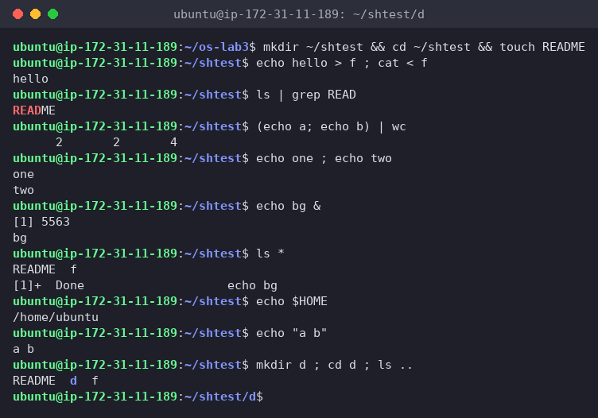
*Figure 2.1 – The commands run in bash*

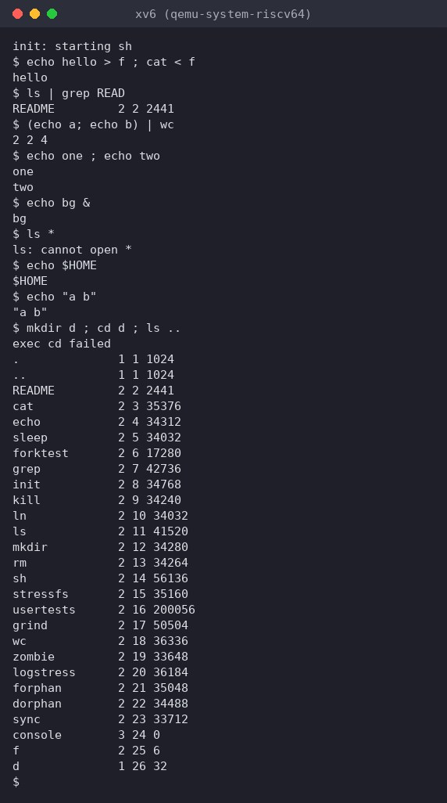
*Figure 2.2 – The same commands run in xv6*

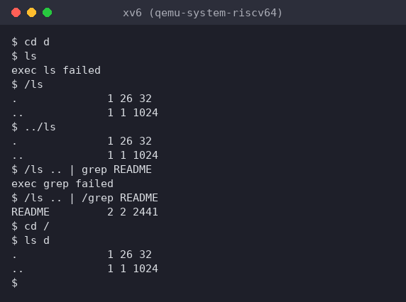
*Figure 2.3 – ls failing after cd d, and the working alternative*

For the last row I pressed Up, Tab and Ctrl+R in both shells:


*Figure 2.4 – bash: Up arrow re-runs the last command, Tab completes `REA` → `README`, Ctrl+R finds `ls | grep READ`*

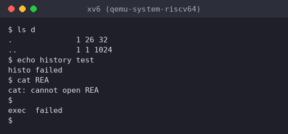
*Figure 2.5 – xv6: the same keys send raw bytes to the shell*

| Command                    | Tests               | bash                                                                           | xv6                                                                                                                                                                                                                                                     |
| -------------------------- | ------------------- | ------------------------------------------------------------------------------ | ------------------------------------------------------------------------------------------------------------------------------------------------------------------------------------------------------------------------------------------------------- |
| `echo hello > f ; cat < f` | redirection         | `hello`                                                                        | `hello`. Same: sh.c opens the file in place of fd 1 / fd 0                                                                                                                                                                                              |
| `ls \| grep READ`          | pipe                | `README`                                                                       | `README  2 2 2441`. Pipe works, the line looks different only because xv6 `ls` prints type, inode, size                                                                                                                                                 |
| `(echo a; echo b) \| wc`   | grouping, list      | `2 2 4`                                                                        | `2 2 4`. Same, both support `( )` and `;`                                                                                                                                                                                                               |
| `echo one ; echo two`      | sequence            | `one` / `two`                                                                  | `one` / `two`. Same                                                                                                                                                                                                                                     |
| `echo bg &`                | background          | `[1] 5563`, `bg`, later `[1]+ Done echo bg`                                    | `bg`. Runs in the background, but there's no job number, no `jobs`, no "Done" message                                                                                                                                                                   |
| `ls *`                     | globbing            | `README  f`                                                                    | `ls: cannot open *`. No globbing: `ls` gets a literal `*` and looks for a file with that name                                                                                                                                                           |
| `echo $HOME`               | variables           | `/home/ubuntu`                                                                 | `$HOME`. No variables, `$` is a normal character                                                                                                                                                                                                        |
| `echo "a b"`               | quotes              | `a b`                                                                          | `"a b"`. Quotes are not special, they stay in the text                                                                                                                                                                                                  |
| `mkdir d ; cd d ; ls ..`   | PATH                | `README  d  f` (now inside `d`)                                                | `exec cd failed`, then `ls ..` lists `/` from the **root**. `cd` is only recognized at the start of a line (see Part 4). Typed alone, `cd d` works, but then `ls` → `exec ls failed` (Figure 2.3)                                                       |
| arrow up, Tab, Ctrl+R      | history, completion | Up recalls the last command, Tab completes file names, Ctrl+R searches history | None. Up sends `ESC [ A`, which xv6 echoes (the terminal treats it as cursor-up, so the line gets garbled) and then tries to run: `… failed`. Tab is just whitespace (`cat REA` → `cannot open REA`). Ctrl+R becomes a `^R` "command": `exec ^R failed` |

**1. Features both shells have, and the ones only bash has**

- **Both:** running programs with arguments, I/O redirection `<` `>` `>>`, pipes `|`, sequences `;`, grouping `( )`, background `&`, and the built-in `cd`.
- **Only bash:** globbing (`*`, `?`, `[ ]`), variables and `$` expansions (`$HOME`, `$?`, `$(...)`, `$((...))`), quoting (`'…'`, `"…"`, `\`), PATH search for programs, `&&` / `||`, job control (`jobs`, `kill %1`, `fg`, "Done" messages), line editing with history (Up, Ctrl+R) and Tab completion, `cd` anywhere in a line, scripts with `if`/`for`, aliases, helpful errors ("command not found" with suggestions instead of `exec X failed`).

**2. In xv6, ls stops working after `cd d`. Why, and how to run ls from inside d anyway?**

xv6 has no PATH. The shell passes the name I typed straight to `exec("ls", argv)`, and the kernel resolves `ls` like any file name, **relative to the current directory**. All xv6 programs live in the root directory `/` (`mkfs` copies `_ls`, `_cat`, … there as `ls`, `cat`, …). At `/`, `ls` happens to be `./ls`. Inside `d` there's no `d/ls`, so: `exec ls failed`.

Fix: give the path to the program myself:

- `/ls` (absolute path) or `../ls` (relative path) work from inside `d` (Figure 2.3)
- the same goes for every program: `/ls .. | grep README` failed with `exec grep failed`, and `/ls .. | /grep README` worked
- or simply `cd /` and run `ls d`

**3. Which missing feature would I miss most, and which would be easiest to add?**

- **Miss most:** command history and line editing (Up arrow / Ctrl+R) together with Tab completion. In xv6, one typo means retyping the whole line, and I use these keys all the time in bash. Globbing would be a close second.
- **Easiest to add:** a PATH fallback. In `runcmd` (`case EXEC`), when `exec(argv[0], …)` fails and the name has no `/`, build `"/" + argv[0]` and call `exec` again. That's about 5 lines and fixes the `ls` after `cd` problem. Making `cd` work after `;` is also easy: handle it inside `runcmd` as a special case. History is much harder, because the xv6 console works line by line (cooked mode) and would need a raw mode to see arrow keys.

**Interesting output**

The `mkdir d ; cd d ; ls ..` line behaved differently than the lab expected: instead of `ls` failing, xv6 printed `exec cd failed` and listed `/`. xv6 only checks whether the *whole line* starts with `cd `. Here the line starts with `mkdir`, so `cd` was treated as a normal program, and there is no `/cd` binary. And since `cd` never ran, `ls ..` ran from `/`, where `..` is `/` itself. Typing `cd d` alone showed the real PATH problem.

## Part 3. Who expands `*`? A program that prints its argv

`user/args.c` for xv6 and its UPROGS line (`$U/_args\`, with a TAB, right after `_sleep`):

```c
#include "kernel/types.h"
#include "user/user.h"

int
main(int argc, char *argv[])
{
  printf("argc = %d\n", argc);
  for(int i = 0; i < argc; i++)
    printf("argv[%d] = [%s]\n", i, argv[i]);
  exit(0);
}
```

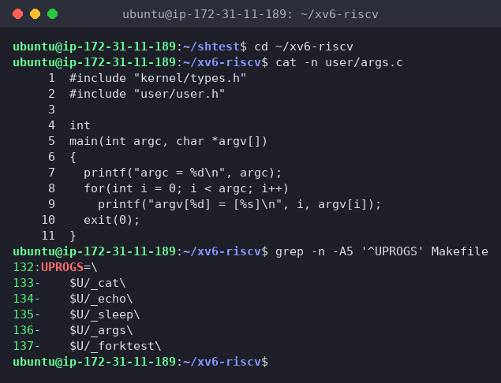
*Figure 3.1 – args.c and the UPROGS line*

`args_linux.c` is the same program with `#include <stdio.h>` and `return 0`:

```c
#include <stdio.h>

int
main(int argc, char *argv[])
{
  printf("argc = %d\n", argc);
  for(int i = 0; i < argc; i++)
    printf("argv[%d] = [%s]\n", i, argv[i]);
  return 0;
}
```

In xv6 (after `make qemu`, which built `_args` and added it to `fs.img`):

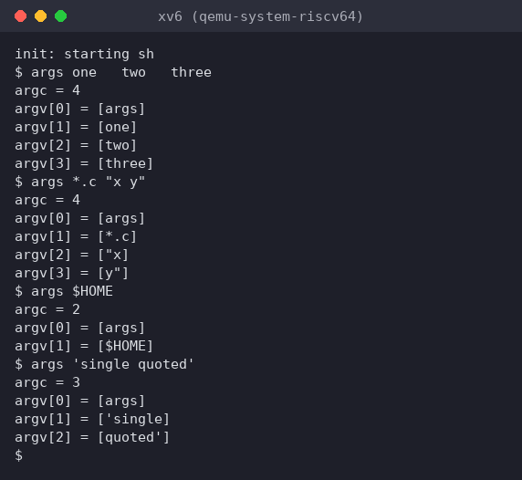
*Figure 3.2 – args output in xv6*

In bash, in `~/os-lab4`, which contains `args_linux.c`, `main.c` and `util.c`, after `gcc -o args args_linux.c`:

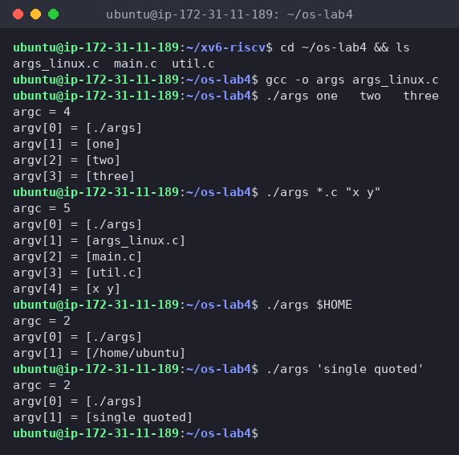
*Figure 3.3 – args_linux output in bash*

| Line | xv6 `argc` / argv | bash `argc` / argv |
|---|---|---|
| `args one   two   three` | 4: `[args] [one] [two] [three]` | 4: `[./args] [one] [two] [three]` |
| `args *.c "x y"` | 4: `[args] [*.c] ["x] [y"]` | 5: `[./args] [args_linux.c] [main.c] [util.c] [x y]` |
| `args $HOME` | 2: `[args] [$HOME]` | 2: `[./args] [/home/ubuntu]` |
| `args 'single quoted'` | 3: `[args] ['single] [quoted']` | 2: `[./args] [single quoted]` |

**1. Both outputs for `args *.c "x y"`. How many arguments did each program receive?**

xv6:
```text
argc = 4
argv[0] = [args]
argv[1] = [*.c]
argv[2] = ["x]
argv[3] = [y"]
```

bash:
```text
argc = 5
argv[0] = [./args]
argv[1] = [args_linux.c]
argv[2] = [main.c]
argv[3] = [util.c]
argv[4] = [x y]
```

Counting `argv[0]` (the program name), xv6's program received **4** and the Linux program **5**. Not counting the name, that's 3 vs 4 real arguments. In xv6 `*.c` arrived unchanged, and `"x y"` was split at the space into two arguments that still carry the quote characters. In bash `*.c` became three file names and `"x y"` arrived as one argument, `x y`, without quotes.

**2. Who turns `*.c` into file names and removes the quotes: the program, the kernel, or the shell?**

**The shell.** It's the same C code and the same `exec()` system call on both systems, and the results differ only because the shells differ. The program just prints what it got, so it can't be the program. The kernel's `exec` copies the `argv` strings into the new process exactly as given, so it isn't the kernel either. bash expanded the glob and removed the quotes *before* calling `exec`. xv6's sh.c does neither, so the raw text reached the program.

**3. What happened to the extra spaces in `one   two   three`?**

They disappeared in **both** shells: each program got exactly `one`, `two`, `three`, with no spaces. Spaces are word separators, and the shell's tokenizer skips any run of whitespace between words (in sh.c, `gettoken` loops `while (strchr(whitespace, *s)) s++`). Spaces never reach the program unless they're protected, like `"x y"` in bash. xv6 can't protect them at all.

**Interesting output**

`argv[0]` differs as well: `[args]` in xv6 vs `[./args]` in bash. `argv[0]` is just whatever the shell passed as the first word, so it's the name I typed, not a fixed program name.

## Part 4. Read the shell

```bash
wc -l user/sh.c
grep -n "#define" user/sh.c        # the kinds of commands
```

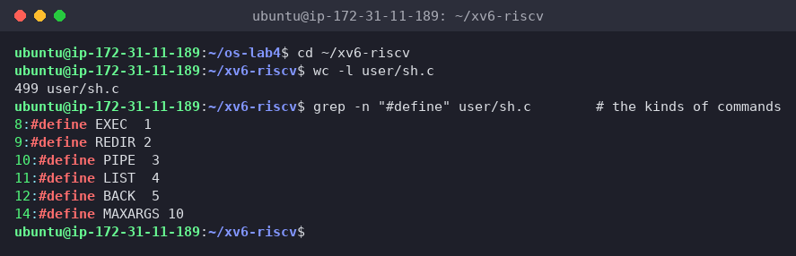
*Figure 4.1 – The command kinds defined in sh.c*

`sh.c` is 499 lines. It defines `EXEC 1`, `REDIR 2`, `PIPE 3`, `LIST 4`, `BACK 5` (and `MAXARGS 10`, the most arguments one command can have).

```bash
grep -n "case " user/sh.c          # where each kind is run
```

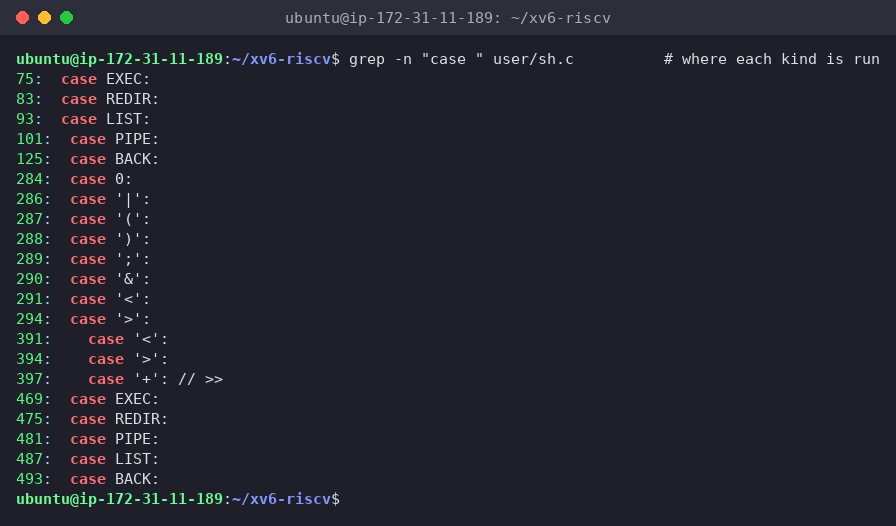
*Figure 4.2 – Where each kind is run*

Three groups of `case`s show the whole design:

- lines **75–125**, `runcmd()`: *executes* each kind. `EXEC` calls `exec()`; `REDIR` does `close(fd)` and then `open(file)`, so the new file gets the lowest free fd; `LIST` forks the left side, waits, then runs the right side; `PIPE` creates `pipe()`, forks two children and connects them with `dup()`; `BACK` forks and does **not** wait.
- lines **284–294**, `gettoken()`: the *tokenizer*. The only special characters are `| ( ) ; & < >` (and `>>` as `'+'`).
- lines **469–493**, `nulterminate()`: walks the tree after parsing and puts `\0` at the end of each word.

```bash
grep -n "cd" user/sh.c | head
```

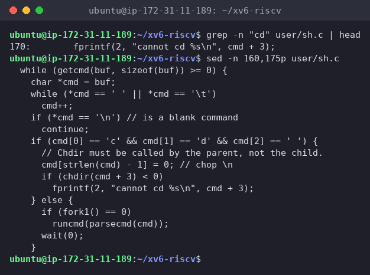
*Figure 4.3 – The code that handles cd*

`grep "cd"` finds only one line, the error message on line 170, because the check is written character by character. `sed -n 160,175p` shows the code in `main()`:

```c
if (cmd[0] == 'c' && cmd[1] == 'd' && cmd[2] == ' ') {
  // Chdir must be called by the parent, not the child.
  cmd[strlen(cmd) - 1] = 0; // chop \n
  if (chdir(cmd + 3) < 0)
    fprintf(2, "cannot cd %s\n", cmd + 3);
} else {
  if (fork1() == 0)
    runcmd(parsecmd(cmd));
  wait(0);
}
```

Finally I searched for any code that handles `*`, `$` or quotes:

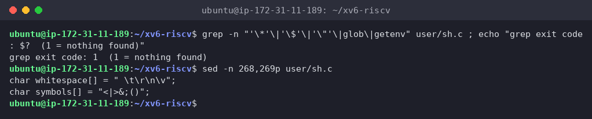
*Figure 4.4 – No code for `*`, `$` or quotes in sh.c; the only special characters*

**1. The five kinds of command and the character that produces each**

| Kind    | Character          | Example                  | What runcmd does                                                |
| ------- | ------------------ | ------------------------ | --------------------------------------------------------------- |
| `EXEC`  | none (plain words) | `ls d`                   | `exec(argv[0], argv)`                                           |
| `REDIR` | `<`, `>`, `>>`     | `cat < f`, `echo hi > f` | close fd 0/1, open the file in its place, run the inner command |
| `PIPE`  | `\|`               | `ls \| grep READ`        | `pipe()`, fork two children, `dup` the ends onto fd 1 / fd 0    |
| `LIST`  | `;`                | `echo one ; echo two`    | fork + run left, `wait`, then run right                         |
| `BACK`  | `&`                | `echo bg &`              | fork, run the command, don't wait                               |

Parentheses `( )` don't have their own kind. `parseblock` just parses what's inside them into a sub-tree, which is how `(echo a; echo b) | wc` became a PIPE whose left side is a LIST.

**2. Where is cd handled, and why isn't it a separate program?**

In `main()`, lines 166–170, *before* the shell forks. If the line starts with `cd `, the shell calls `chdir()` itself; every other line is forked and run by a child with `runcmd`. As the comment says: *"Chdir must be called by the parent, not the child."* The current directory belongs to each process. A child (or a `/cd` program) would change only its own directory and then exit, and the shell would stay where it was, the same reason `cd` is a built-in in bash (Lab 3). This also explains my Part 2 result: since the check only looks at the **start** of the line, `mkdir d ; cd d` sends `cd` to a child as a normal `EXEC`, giving `exec cd failed`.

**3. Code that handles `*` or `$`? What does it explain about Part 2?**

There's **none**. The grep for `'*'`, `'$'`, `'"'`, `glob` and `getenv` found nothing (exit code 1), and the only special characters are `whitespace[] = " \t\r\n\v"` and `symbols[] = "<|>&;()"`. Everything else is an ordinary word character. That explains all the "only bash" rows in Part 2:

- `ls *` → `ls` got a literal `*` → `ls: cannot open *`
- `echo $HOME` → printed `$HOME`, since there are no variables and no environment at all
- `echo "a b"` → printed `"a b"`, and `args "x y"` gave `["x]` `[y"]`, since quotes are normal characters and the space still splits the words
- `args *.c` → `[*.c]`, the program saw exactly what I typed

**Interesting output**

The `>>` case on line 397 opens the file with `O_WRONLY | O_CREATE`, without `O_TRUNC` and without any append flag (xv6's `fcntl.h` doesn't even have `O_APPEND`), so from reading the code, xv6's `>>` writes from the *start* of the file over the old contents instead of appending like bash does. And the `BACK` case explains why `echo bg &` has no "Done" message: the shell forks and simply never waits for that child or reports on it.

## Wrap-up

Using the two shells side by side showed that a shell's *essential* job is small: read a line, split it into words, build a tree of EXEC/REDIR/PIPE/LIST/BACK commands, and run it with `fork`, `exec`, `wait`, `pipe`, `dup`, `open` and `close`, plus `cd` as a built-in because only the shell process can change its own directory. xv6 does all of that in 499 lines, and redirection, pipes, lists, grouping and background jobs worked the same in both shells. Everything else I'm used to is bash adding comfort *on top*: globbing, variables, quoting, PATH search, `&&`/`||`, job control, history and completion. The `args` program proved where that happens: the same C code and the same `exec()` received `[*.c]` `["x]` `[y"]` from xv6 but three file names and `[x y]` from bash, so it's the shell, not the program or the kernel, that expands `*` and removes quotes. I also got `sleep` building on the current xv6 by calling `pause()`, and saw that 20 ticks ≈ 2 seconds.
