# Lab 5 · The File System with Your Own Hands (Linux)

**Nichita Rusnac, FAF-242** · Technical University of Moldova, FCIM · Operating Systems · Laboratory work no. 5

The formatted report (title page, contents, figures) is [`Lab5_NichitaRusnac_FAF-242.docx`](Lab5_NichitaRusnac_FAF-242.docx).

All screenshots below come from my own terminal session, in the order I ran the commands. I did the lab on my Ubuntu 24.04 ARM (`aarch64`) machine on AWS, connected over SSH, as my normal user `ubuntu`.

## Purpose of the work

- see the Linux file tree and the different file types (regular file, directory, symlink, character and block devices)
- understand that a file is an **inode** and that names are only directory entries pointing to it, through hard and symbolic links
- learn how permissions work on files and on directories, what umask does, and what the special bits (setuid, sticky) are for
- look at the disks and partitions underneath, and at the kernel exposed as files in `/proc`

## Before you start

```bash
whoami          # must not print root
mkdir -p ~/os-lab5 && cd ~/os-lab5
```

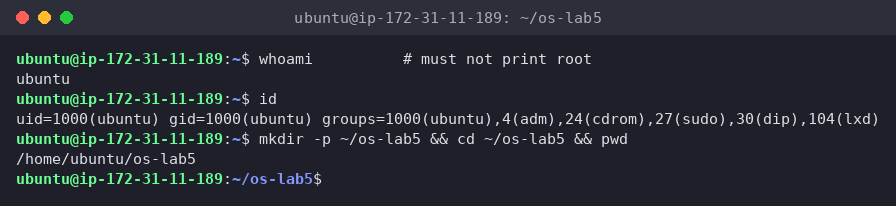
*Figure 0.1 – Working as the normal user ubuntu (UID 1000), not root*

`whoami` prints `ubuntu` (UID 1000). I'm in the `sudo` group, but I only used `sudo` where the lab asked for it (stretch d) and once to compare `du` results. Everything else ran without privileges, so the permission experiments are honest.

## Part 1. The tree and the file types

```bash
ls /
ls -ld /etc /etc/passwd /bin /dev/null /tmp
```

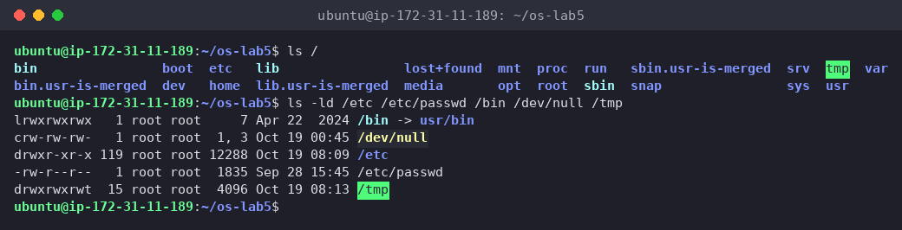
*Figure 1.1 – The root of the tree and the types of five paths*

```bash
ls -l /dev | head
ls -l /dev | grep '^b'     # block devices (my addition)
```

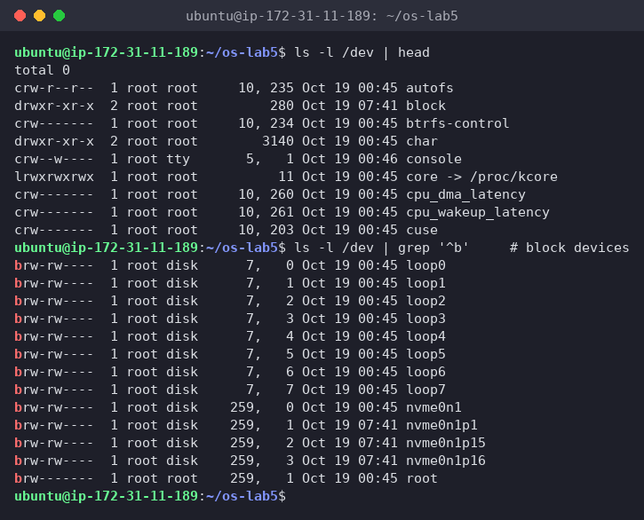
*Figure 1.2 – Character and block devices in /dev*

```bash
file /usr/bin/ls /etc/passwd /bin
du -sh /var/log 2>/dev/null ; du -sh /usr 2>/dev/null
```

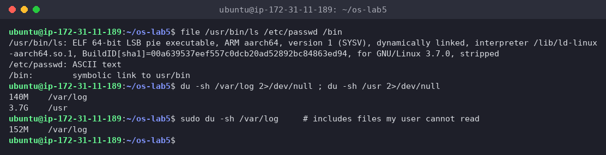
*Figure 1.3 – file and du*

**(1) The type of each path, from the first letter of `ls -l`**

| Path | First letter | Type |
|---|---|---|
| `/etc` | `d` | directory |
| `/etc/passwd` | `-` | regular file (`file` says `ASCII text`) |
| `/bin` | `l` | symbolic link (`/bin -> usr/bin`) |
| `/dev/null` | `c` | character device (major 1, minor 3) |
| `/tmp` | `d` | directory, with the sticky bit: `drwxrwxrwt` (see Part 3) |

**(2) What is `/bin` on my system?**

A **symbolic link** to `usr/bin` (relative target, so `/usr/bin`). `ls -ld` shows `lrwxrwxrwx … /bin -> usr/bin` and `file /bin` says `symbolic link to usr/bin`. Ubuntu uses the "merged /usr" layout: `/bin`, `/sbin` and `/lib` are all links into `/usr`. That's also why `ls /` shows the leftover marker entries `bin.usr-is-merged`, `lib.usr-is-merged` and `sbin.usr-is-merged`.

**(3) One character device and one block device in /dev**

- character device: `/dev/console` (`crw--w---- root tty 5, 1`) or `/dev/null` (`c … 1, 3`). They're read and written as a stream of bytes.
- block device: `/dev/nvme0n1` (`brw-rw---- root disk 259, 0`), my whole NVMe disk, accessed in fixed-size blocks with random access. `ls -l /dev | head` showed no block devices, since only `c`, `d` and `l` appear among the first lines, so I filtered with `grep '^b'`.

**(4) Which is bigger, `/var/log` or `/usr`, and by how much?**

`/usr` is much bigger: **3.7 G** vs **140 M** for `/var/log`, about **25–27 times** bigger. (`sudo du` counts 152 M for `/var/log`, because as `ubuntu` I can't enter some log directories and `2>/dev/null` hid those errors.) It makes sense: `/usr` holds all installed programs and libraries, while `/var/log` only holds text logs, which are rotated and compressed.

**Interesting output**

`file /usr/bin/ls` says `ELF 64-bit LSB pie executable, ARM aarch64`. `file` doesn't look at the name at all, it reads the first bytes of the file (more on this in stretch a).

## Part 2. Inodes and links

### 1. An inode, and a name that is not part of it

```bash
echo hello > notes.txt
stat notes.txt
ls -li notes.txt
```

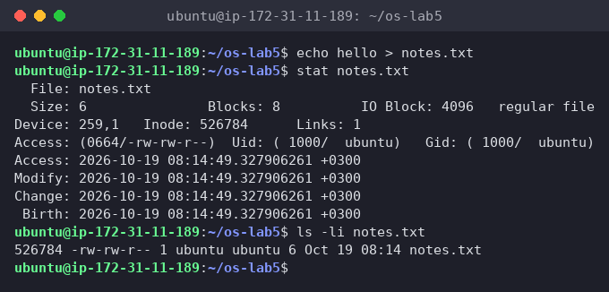
*Figure 2.1 – stat and ls -li on notes.txt*

### 2. Hard link, then remove the "original"

```bash
ln notes.txt hard.txt
ls -li notes.txt hard.txt
rm notes.txt
cat hard.txt ; ls -li hard.txt
```

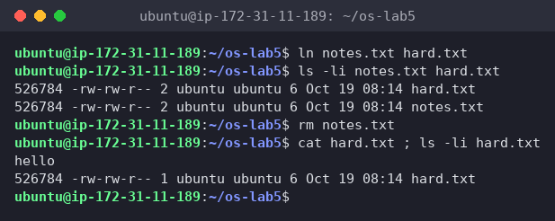
*Figure 2.2 – A hard link survives rm of the original name*

Both names show the **same inode** `526784` and the link count went from 1 to **2**. After `rm notes.txt`, `hard.txt` still printed `hello` and the count went back to **1**.

### 3. Symbolic link, then remove its target

```bash
ln -s hard.txt soft.txt
ls -li hard.txt soft.txt
cat soft.txt
rm hard.txt
cat soft.txt ; ls -l soft.txt
```

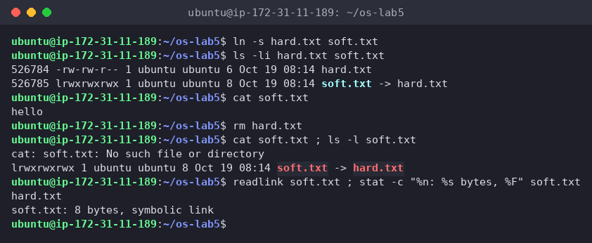
*Figure 2.3 – A symbolic link breaks when its target is removed*

`soft.txt` got its **own inode** `526785`, type `l`, size **8**. `cat soft.txt` worked while `hard.txt` existed, then failed with `No such file or directory` after `rm hard.txt`, even though `ls -l soft.txt` still shows `soft.txt -> hard.txt`.

### 4. Directories have links too

My prediction, written down before running: 2 for a new directory, 4 after two subdirectories.

```bash
mkdir d ; ls -ld d
mkdir d/x d/y ; ls -ld d
```

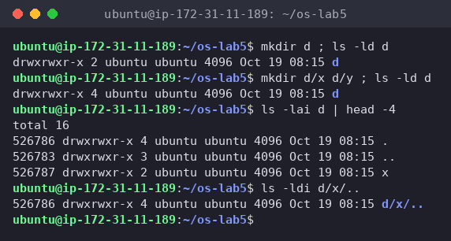
*Figure 2.4 – Link count of a directory: 2, then 4*

The prediction was correct: `2`, then `4`. I added `ls -lai d` and `ls -ldi d/x/..` to show *where* the links are: `d`'s own `.` and `d/x/..` both have inode `526786`, the same as `d`.

### 5. Size is not space

```bash
echo x > one.txt ; ls -l one.txt ; du -h one.txt
truncate -s 1G big.img ; ls -lh big.img ; du -h big.img
rm big.img
```

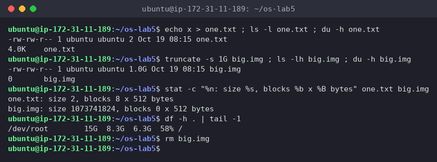
*Figure 2.5 – Apparent size vs disk usage: 2 B → 4.0K, 1 G → 0*

`one.txt`: size **2** bytes, but `du` says **4.0K** (8 blocks × 512 B). `big.img`: size **1.0 G**, but `du` says **0** (0 blocks), and the free space on `/` didn't change.

**(1) Which number in stat is the inode, and which tells how many names the file has?**

`Inode: 526784` is the inode number. `Links: 1` is the link count, the number of directory entries (names) that point to this inode. `ls -li` shows the same two numbers: the first column (inode) and the number after the permissions (links).

**(2) After `rm notes.txt`, why could I still read `hard.txt`? What does rm really remove?**

`notes.txt` and `hard.txt` were two names for one inode (same number `526784`). Neither name is "the original", they're equal. `rm` calls `unlink()`, which removes **only the name** (the directory entry) and decrements the link count, here from 2 to 1. The inode and its data blocks are freed only when the link count reaches **0** *and* no process has the file open (stretch c shows the second condition). Since `hard.txt` still pointed at the inode, the data was untouched.

**(3) Why did `cat soft.txt` fail at the end, although `soft.txt` still exists? How big is it, and why exactly that size?**

A symbolic link doesn't point at an inode. It's a tiny separate file whose content is a **path** (`hard.txt`). When I open it, the kernel reads that path and looks it up again. After `rm hard.txt` there's no name `hard.txt` anymore, so the lookup fails with `No such file or directory`, a "dangling" link. The link itself (inode `526785`) still exists. Its size is **8 bytes**, exactly the length of the string `hard.txt` (8 characters, no terminating zero stored), as `readlink` confirms.

**(4) A new directory has 2 links, and 4 after two subdirectories. Where does each link come from?**

- link 1: the entry `d` in its parent `~/os-lab5`
- link 2: the entry `.` inside `d`, which points to `d` itself
- links 3 and 4: the `..` entries inside `d/x` and `d/y`, which point back to their parent `d` (confirmed: `d/x/..` is inode `526786`)

So for a directory, link count = 2 + number of subdirectories. (The parent `os-lab5` also went up by one when I created `d`, which is why `..` in Figure 2.4 shows 3 links.)

**(5) Why does a 2-byte file use 4.0K, and a 1 GB file use 0?**

- The file system hands out space in whole **blocks** of 4096 bytes (`IO Block: 4096` in `stat`), so even 2 bytes (`x` plus a newline) take one full 4 KiB block. `ls -l` shows the logical size, and `du` shows the blocks actually allocated.
- `truncate -s 1G` only sets the size field in the inode and writes no data. That makes a **sparse file**: reading any part returns zeros, but no blocks are allocated until something is written, so it uses 0 bytes on disk. This is how VM disk images can be "1 GB" while using almost nothing.

**Interesting output**

`stat` also shows `Birth:`, the creation time. ext4 stores it, and newer `stat` versions can read it. For years Linux tools could only show access, modify and change times.

## Part 3. Permissions

### 6. Files

```bash
echo secret > s.txt
chmod 600 s.txt ; ls -l s.txt
chmod 000 s.txt ; cat s.txt
chmod u+r s.txt ; cat s.txt
umask ; touch new.txt ; mkdir newdir ; ls -ld new.txt newdir
```

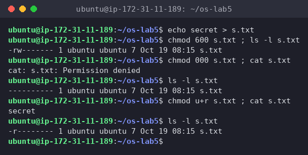
*Figure 3.1 – chmod 600, 000 and u+r on my own file*

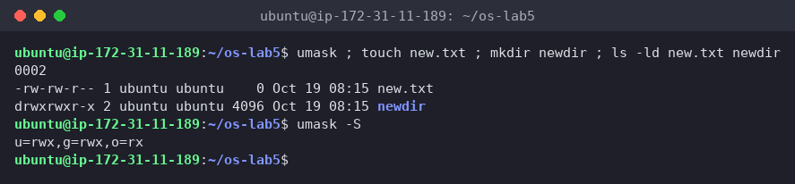
*Figure 3.2 – umask and the permissions of a new file and directory*

With `000` even I, the owner, got `Permission denied`. After `chmod u+r` (`-r--------`) I could read it again.

### 7. Directories

My predictions, written down before running (in `~/os-lab5/predictions.md`):

- read only (`u=r`): `ls box` shows the name `f`, but with errors for the details, and `cat box/f` → Permission denied
- execute only (`u=x`): `ls box` → Permission denied, and `cat box/f` prints `hi`

```bash
mkdir box ; echo hi > box/f
chmod u=r,go= box ; ls box ; cat box/f     # read only
chmod u=x,go= box ; ls box ; cat box/f     # execute only
chmod 755 box
```

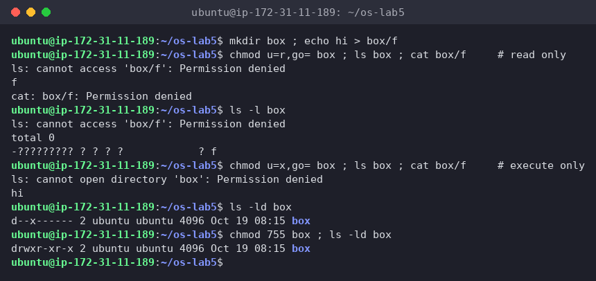
*Figure 3.3 – The box experiment: r vs x on a directory*

All predictions were correct:

- `r` only: `ls box` printed `f`, plus `ls: cannot access 'box/f': Permission denied`, because the `--color=auto` alias makes `ls` call `stat` on each name to choose a color. `ls -l box` shows `-????????? ? ? ? ? ? f`: the name is visible, everything in the inode is not. `cat box/f` → `Permission denied`.
- `x` only: `ls box` → `cannot open directory 'box': Permission denied`, but `cat box/f` printed **`hi`**.

### 8. Special bits and other people's files

```bash
ls -l /usr/bin/passwd ; ls -ld /tmp
cat /etc/shadow
ls -l /etc/shadow
```

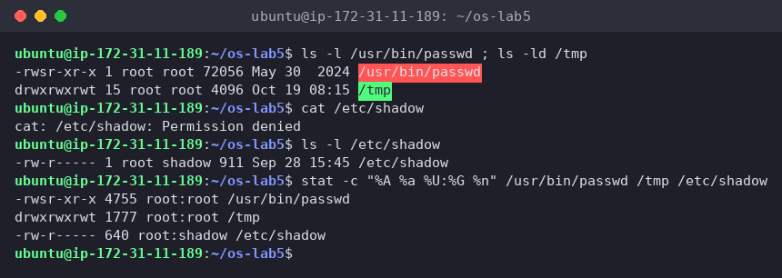
*Figure 3.4 – setuid on passwd, sticky bit on /tmp, and /etc/shadow*

**(1) 600, 644, 755 and 700 as rwx strings, with one real use for each**

Each digit is r=4 + w=2 + x=1, for owner / group / others:

| Octal | rwx | Real use |
|---|---|---|
| 600 | `rw-------` | private files only I may read or change: `~/.ssh/id_ed25519` (ssh refuses keys that others can read), `~/.bash_history` |
| 644 | `rw-r--r--` | normal files everyone may read but only the owner edits: `/etc/passwd`, web pages, documents |
| 755 | `rwxr-xr-x` | programs and public directories: `/usr/bin/*`, my `report.sh` from Lab 3, `/etc` |
| 700 | `rwx------` | private directories or scripts: `~/.ssh` itself, my home directory on a shared server |

**(2) With `chmod 000` I own the file but can't read it. Why doesn't ownership help?**

The kernel checks permissions in a fixed order and stops at the first category that matches: if I'm the **owner**, only the **owner bits** are used, and the group and others bits are never looked at. With `000` the owner bits are `---`, so read is refused even though I own the file. What ownership *does* give is the right to **change the mode**: only the owner (or root) can `chmod`, which is how `chmod u+r` gave me access back. (root would have read it anyway, since root skips these checks, which is why the lab says not to work as root.)

**(3) My umask, and how it explains `new.txt` and `newdir`**

`umask` is **0002** (`u=rwx,g=rwx,o=rx`). Programs create files asking for `666` (rw for everyone) and directories asking for `777`, and the kernel clears the bits that are set in the umask:

- `new.txt`: 666 with the `002` bit cleared = **664** = `-rw-rw-r--`
- `newdir`: 777 with the `002` bit cleared = **775** = `drwxrwxr-x`

The umask removes only "write for others". Group write stays because Ubuntu gives every user a private group with the same name (`ubuntu`), so group write is safe.

**(4) The box experiment: what does r allow on a directory, and what does x allow?**

A directory is a table of (name → inode) entries:

- **r** = read the table, so you can **list the names**. Without `x` you can't go *through* the directory to the inodes, so you see `f` but not its size, owner or permissions, and you can't open it.
- **x** = "search/traverse": you can **use** a name you already know to reach the inode, so `cat box/f` works, `cd box` works, and so on. Without `r` you just can't list what's inside.
- (**w** would allow adding, removing and renaming entries, and it needs `x` too.)

So `x` without `r` works like a hidden directory: files can be reached only if you know the exact name.

**(5) The `s` in `/usr/bin/passwd`, the `t` in `/tmp`, and why passwd needs the `s`**

- `s` in the owner's execute position (`-rwsr-xr-x`, octal **4755**) is the **setuid** bit: the program runs with the permissions of the file's **owner** (root), not of the user who started it.
- `t` in the others' execute position (`drwxrwxrwt`, octal **1777**) is the **sticky** bit: everyone may create files in `/tmp`, but a file can only be deleted or renamed by its owner (or the directory's owner, or root). Without it, any user could delete other users' temp files, since `w` on a directory normally allows removing any entry.
- `passwd` has to write my new password hash into `/etc/shadow`, which is `-rw-r----- root shadow`. As `ubuntu` I can't even read it (`cat /etc/shadow` → `Permission denied`). With setuid root, `passwd` runs as root and can update the file, and the program itself makes sure I can only change *my own* password.

**Interesting output**

`ls -l box` printing a row of `?` was the clearest way to see that the name and the inode are separate things: with `r` alone, the directory gives up the names but not a single field of the inodes.

## Part 4. Disks and the kernel as files

```bash
lsblk
df -h
mount | grep " / "
```

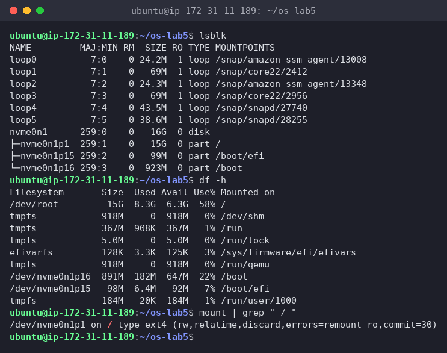
*Figure 4.1 – lsblk, df -h and the root mount*

```bash
grep -c processor /proc/cpuinfo
head -3 /proc/meminfo
head -5 /proc/self/status
ls -l /proc/self/fd
```

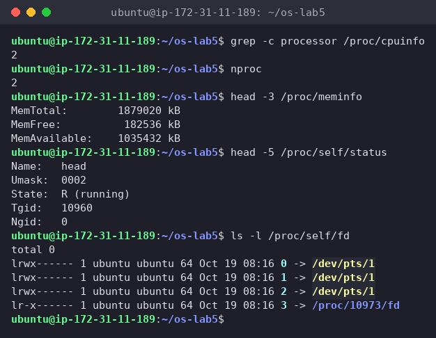
*Figure 4.2 – CPU, memory and the process itself, read from /proc*

**(1) Drawing of my disk**

```text
nvme0n1   (NVMe SSD, 16 GiB, block device 259:0)
├── nvme0n1p1    15 GiB   ext4   mounted on  /          ← root file system
├── nvme0n1p15   99 MiB   vfat   mounted on  /boot/efi  (EFI system partition)
└── nvme0n1p16  923 MiB   ext4   mounted on  /boot      (kernels, initrd)

loop0 … loop5   24–69 MiB, read-only squashfs images mounted under /snap/…
```

`mount | grep " / "` confirms it: `/dev/nvme0n1p1 on / type ext4 (rw,relatime,discard,errors=remount-ro,commit=30)`. The file system types of the other two partitions come from `lsblk -f`. `df` names the root device `/dev/root`, an alias for the same partition. The `loop` devices aren't real disks: each one is a snap package file mounted as if it were a small disk.

**(2) How full is my root file system?**

**58%**: 8.3 G used of 15 G, 6.3 G available (`/dev/root 15G 8.3G 6.3G 58% /`). The `tmpfs` lines (`/run`, `/dev/shm`, …) live in RAM, not on the disk.

**(3) CPU cores and RAM according to /proc**

- `grep -c processor /proc/cpuinfo` → **2** cores (`nproc` agrees)
- `MemTotal: 1879020 kB` ≈ **1.8 GiB** RAM, of which about 1.0 GiB is available (`MemAvailable: 1035432 kB`)

**(4) /proc/self/status showed the name of a program. Which one, and why?**

`Name: head`. `/proc/self` is a magic link that always points to the `/proc/<PID>` directory of **the process that is reading it**. The process that opened `/proc/self/status` was `head` (PID 10960), not bash and not the shell before it, so it saw its own status: `State: R (running)`, since it was running at that moment. In the same way, `ls -l /proc/self/fd` listed `ls`'s own open files: 0, 1 and 2 on my terminal `/dev/pts/1`, and fd 3, the `/proc/<pid>/fd` directory `ls` itself had open to read it.

**Interesting output**

`/proc` takes no disk space at all (`ls -l /dev` showed `total 0` too). The kernel creates these "files" when you read them, which is how one `cat` or `grep` works for both real files and live kernel data.

## Stretch (all four)

The lab asks for any two. I did all four.

### (a) Magic numbers

```bash
gzip -c /etc/passwd > notes.txt ; file notes.txt ; xxd notes.txt | head -1
```

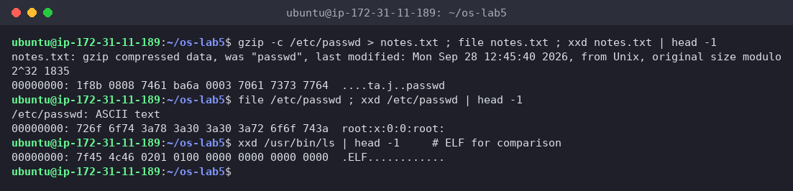
*Figure 5.1 – file ignores the .txt name and reads the magic bytes*

Even though it's called `notes.txt`, `file` says **`gzip compressed data, was "passwd"`**. The first bytes are `1f 8b`, the gzip **magic number**, followed by `08` (compression method = deflate). Then come flags, a timestamp, and even the original name `passwd` in plain text. For comparison, `/etc/passwd` starts with readable ASCII (`root:x:0:0:`), and an ELF program starts with `7f 45 4c 46` = `\x7f E L F`. On Linux the extension means nothing to the kernel, it's just part of the name.

### (b) Hunting for setuid programs

```bash
find / -xdev -perm -4000 -type f 2>/dev/null
```

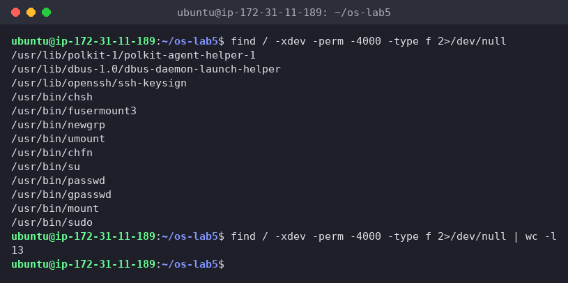
*Figure 5.2 – All setuid programs on the root file system*

**13** setuid programs. The classic ones are `passwd`, `su`, `sudo`, `mount`, `umount`, `chsh`, `chfn`, `newgrp` and `gpasswd`. The less familiar ones on this server are:

- `polkit-agent-helper-1`: PolicyKit authentication helper
- `dbus-daemon-launch-helper`: starts system D-Bus services
- `ssh-keysign`: OpenSSH host-based authentication, needs to read the root-only host key
- `fusermount3`: lets normal users mount FUSE file systems

I compared against the classic tools, not the lecture slide itself. The point stands: every setuid-root binary has to be trusted, because a bug in it is a way to become root, which is why admins check this list.

### (c) Deleting a file that is still open

```bash
exec 3< bigfile ; rm bigfile ; ls -l /proc/$$/fd
```

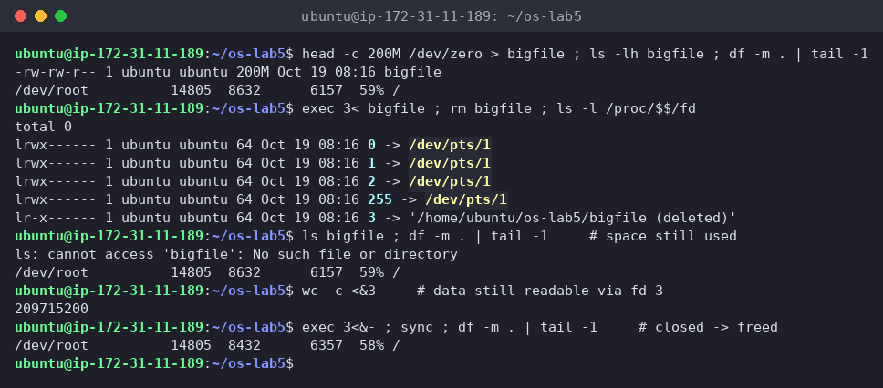
*Figure 5.3 – A deleted but open file keeps its space until it is closed*

I made a 200 MB `bigfile` first, so the effect is visible in `df`. After `rm`:

- `ls bigfile` → `No such file or directory`, the name is gone
- the link in `/proc/$$/fd` says **`3 -> '/home/ubuntu/os-lab5/bigfile (deleted)'`**
- `df` still shows **8632 MB used**, so the space was *not* freed, and `wc -c <&3` could still read all 209715200 bytes through fd 3
- after `exec 3<&-` (closing fd 3): **8432 MB used**, exactly 200 MB less

So the space is freed only when **both** the link count is 0 **and** the last open file descriptor is closed. This is the classic "disk full but `du` shows nothing" problem: a deleted log file still held open by a running service. The fix is to restart or signal the service, not to delete more files.

### (d) A file system inside a file

```bash
truncate -s 64M disk.img ; mkfs.ext4 disk.img
sudo mount -o loop disk.img /mnt ; df -h /mnt ; df -i /mnt ; sudo umount /mnt
```

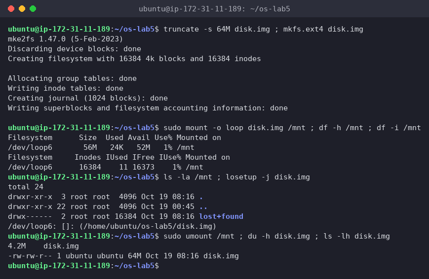
*Figure 5.4 – mkfs.ext4 on a 64 MB file, mounted through a loop device*

`mkfs.ext4` said **`Creating filesystem with 16384 4k blocks and 16384 inodes`**, and `df -i` confirmed **16384 inodes**, 11 already used (the root directory, `lost+found` and reserved inodes 1–10). One inode per 4 KiB block comes from `/etc/mke2fs.conf`: file systems under 512 MB get the "small" profile with `inode_ratio = 4096`. The number of inodes is fixed at `mkfs` time, so a disk can run out of inodes while it still has free space. `df -h` shows 56 M instead of 64 M because the journal (1024 blocks = 4 MiB), the inode tables and the reserved blocks take the rest. The kernel attached the file to `/dev/loop6`, so it looked like a real disk. Also, `disk.img` is `64M` in `ls -l` but only **4.2M** in `du`, another sparse file, since only the metadata was ever written.

## Wrap-up

This lab made the lecture's model of the file system concrete. A file is an **inode** (type, permissions, owner, size, link count, block pointers), and names are just entries in directories that point to it. That explains everything I saw: a hard link is a second name for the same inode (same number, count 2), `rm` only removes a name, the data disappears when the last name *and* the last open descriptor are gone, and a symbolic link is a separate small file holding a path, which breaks when that path disappears. Directory link counts (2 + subdirectories) come from `.` and `..`. Logical size and disk usage differ because of whole blocks and sparse files. Permissions are checked against owner, then group, then others; on directories `r` lists names and `x` lets you use them; umask trims new files to 664 and directories to 775; and setuid and sticky solve two real problems (`passwd` writing `/etc/shadow`, a shared `/tmp`). Underneath it all is a 16 GB NVMe disk with an ext4 root partition, and `/proc` shows that the kernel itself can be read as files.
