# Lab 6 · Inside the xv6 File System

**Nichita Rusnac, FAF-242** · Technical University of Moldova, FCIM · Operating Systems · Laboratory work no. 6

The formatted report (title page, contents, figures) is [`Lab6_NichitaRusnac_FAF-242.docx`](Lab6_NichitaRusnac_FAF-242.docx).

All screenshots below come from my own session, in the order I ran the commands. xv6 commands ran at the xv6 `$` prompt inside QEMU (`make qemu`), and the rest ran in bash on my Ubuntu 24.04 ARM machine on AWS, in `~/xv6-riscv` (revision `06aad25`). The code I hand in (`mystat.c`, `find.c`, `Makefile`) is next to this note in the `Lab6/` folder, together with `dirdump.py`, a small helper I wrote to look at directories inside `fs.img`.

## Purpose of the work

- read what xv6's `ls` shows and decode it with `kernel/stat.h` and `kernel/fs.h`: types, inode numbers, directory entries
- write `mystat`, a program that calls `stat()`, and use it to watch hard links being created and removed
- find where the kernel decrements the link count and frees the blocks, and what an xv6 on-disk inode contains
- measure the limits written in `kernel/fs.h` (name length, largest file, disk layout)
- write `find`, which walks the directory tree recursively (the MIT 6.1810 util lab exercise)

## Before you start

```bash
bash os2026-setup.sh --check
```

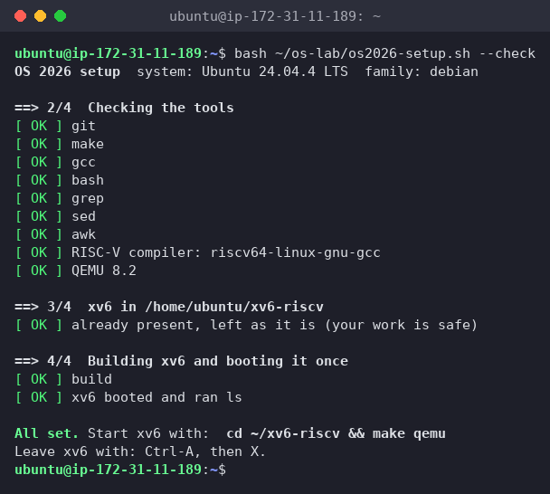
*Figure 0.1 – The setup check passes*

My tree already had `sleep` (Lab 2/4) and `args` (Lab 4) in UPROGS. For Part 1 I started from a clean disk with `make clean ; make qemu`.

## Part 1. Read what xv6 shows you

```text
$ ls
$ mkdir a
$ ls a
```

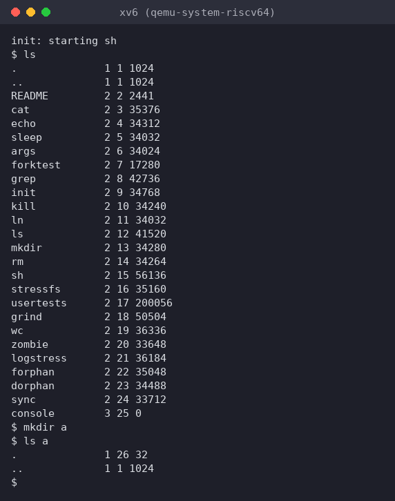
*Figure 1.1 – ls on a fresh xv6 disk, then mkdir a and ls a*

Each line is name, type, inode number, size. To decode the type I opened `kernel/stat.h`, and in `kernel/fs.h` I looked up the root inode and the directory entry:

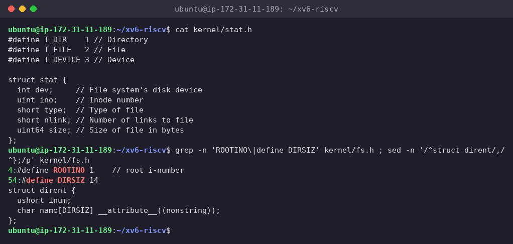
*Figure 1.2 – kernel/stat.h, ROOTINO, DIRSIZ and struct dirent*

To see a directory's bytes for myself, I wrote `dirdump.py`. It reads the superblock of `fs.img`, finds an inode, and prints each 16-byte entry of that directory (I ran it after a later session, when `a` was inode 28 and had a subdirectory `b`):

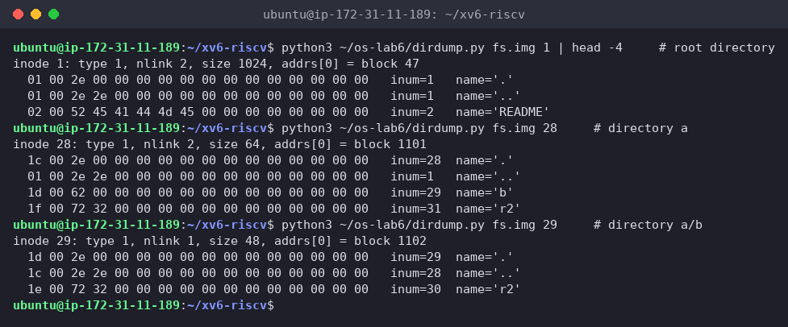
*Figure 1.3 – Raw directory entries inside fs.img: root, a and a/b*

**(1) What do types 1, 2 and 3 mean?**

From `kernel/stat.h`: `T_DIR 1` = directory, `T_FILE 2` = regular file, `T_DEVICE 3` = device. So `.`/`..` are directories, `README`, `cat`, … are files, and `console 3 25 0` is the console device (size 0, since it has no data blocks, like `/dev/console` on Linux).

**(2) Which inode number does the root directory have, and why are `.` and `..` the same there?**

Inode **1** (`#define ROOTINO 1`; inode 0 is never used, it marks a free directory slot). Both `.` and `..` show `1 1 1024`. `.` always points to the directory itself. The root has no parent, so when `mkfs` builds the disk it makes root's `..` point to root itself, which is why `cd ..` at `/` stays at `/`. Figure 1.3 shows it in the raw bytes: both of root's first entries start with `01 00`, inode 1.

**(3) An empty directory has size 32. How big is one entry, and which two entries does `a` contain?**

One entry is **16 bytes**: `struct dirent { ushort inum; char name[DIRSIZ]; }` = 2 bytes for the inode number + 14 bytes (`DIRSIZ`) for the name. 32 / 16 = 2 entries:

- `.` → `a` itself (inode 26 in Figure 1.1)
- `..` → the parent, root (inode 1)

In Figure 1.3, `a` with two more entries (`b` and `r2`) has size 64 = 4 × 16, so a directory really is just a file holding a table of these entries.

**Interesting output**

A directory's size grows 16 bytes at a time, and `ls` shows it in the size column (`a 1 26 32`), while on Linux directories show 4096. xv6 doesn't round up to a block in the size field.

## Part 2. Write mystat

I completed `user/mystat.c` and added `$U/_mystat\` to UPROGS:

```c
#include "kernel/types.h"
#include "kernel/stat.h"
#include "user/user.h"

char *
typename(int t)
{
  switch(t){
  case T_DIR:
    return "directory";
  case T_FILE:
    return "file";
  case T_DEVICE:
    return "device";
  }
  return "?";
}

int
main(int argc, char *argv[])
{
  struct stat st;

  for(int i = 1; i < argc; i++){
    if(stat(argv[i], &st) < 0){
      fprintf(2, "mystat: cannot stat %s\n", argv[i]);
      continue;
    }
    printf("%s: %s, inode %d, links %d, size %d bytes\n",
           argv[i], typename(st.type), st.ino, st.nlink, (int)st.size);
  }
  exit(0);
}
```


*Figure 2.1 – mystat.c and the UPROGS lines (`^I` = TAB, nothing after the backslash)*

`stat()` isn't a separate system call in xv6. It's a library function in `user/ulib.c` that does `open` + `fstat` + `close`. On an error my program prints to fd 2 and goes on with the next argument, as the TODO asks.

```text
$ mystat README . console
$ ln README r2
$ mystat README r2
$ rm README
$ mystat r2
$ cat r2 | wc
```

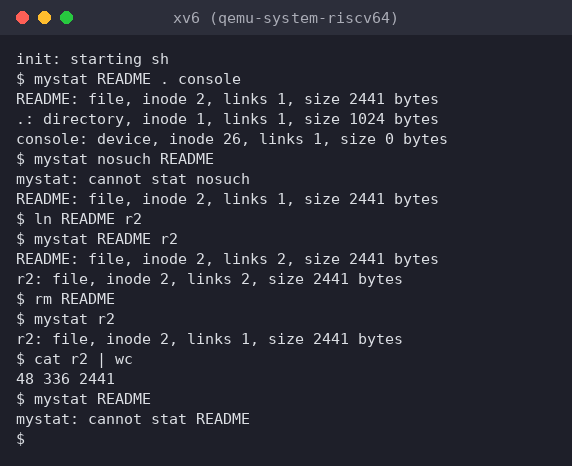
*Figure 2.2 – mystat watching a hard link being created and the original name removed*

The first line matches the lab's example, except `console`, which is inode 26 on my disk because of my two extra programs (`sleep`, `args`) and `mystat`. I also tested the error path: `mystat nosuch README` printed `mystat: cannot stat nosuch` and still handled `README`.

On the host I looked for the code that removes a link and frees the blocks, and at the on-disk inode:

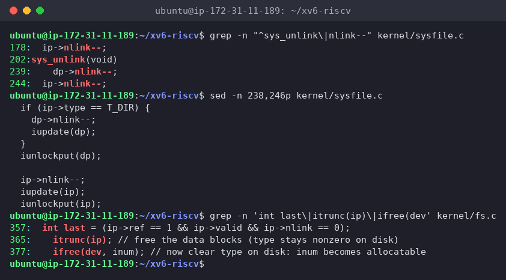
*Figure 2.3 – nlink-- in sys_unlink, and where iput() frees the blocks*

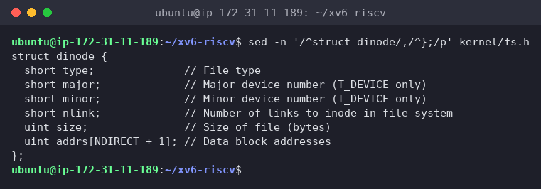
*Figure 2.4 – struct dinode in kernel/fs.h*

**(1) Outputs after `ln` and after `rm`. What changed and what didn't?**

After `ln README r2`:
```text
README: file, inode 2, links 2, size 2441 bytes
r2: file, inode 2, links 2, size 2441 bytes
```
After `rm README`:
```text
r2: file, inode 2, links 1, size 2441 bytes
$ cat r2 | wc
48 336 2441
```

- **changed:** only the **link count**, 1 → 2 after `ln`, back to 1 after `rm`. `README` no longer exists (`mystat README` → `cannot stat README`).
- **didn't change:** the inode number (**2**), the type, the size (**2441**) and the content. `wc` gives `48 336 2441`, exactly what `README` gave in Lab 2. `ln` didn't copy anything, it added a second directory entry pointing to inode 2, and `rm` removed one entry.

**(2) The line in `sys_unlink` that decrements the link count. When are the data blocks freed?**

`kernel/sysfile.c`, **line 244**: `ip->nlink--;` followed by `iupdate(ip)`, which writes the inode back to disk. (Line 239, `dp->nlink--`, is for removing a *directory*: the parent loses the link from the child's `..`. Line 178 is in `sys_link`'s error path, which undoes a failed `link`.)

`sys_unlink` itself frees **no blocks**. That happens in `iput()` in `kernel/fs.c` (lines 357–377). When the last in-memory reference to an inode is dropped, it checks `ip->ref == 1 && ip->valid && ip->nlink == 0`. Only when that's true does it call `itrunc(ip)` (`bfree` on every direct block, every block listed in the indirect block, and the indirect block itself) and then `ifree()` to mark the inode free. So the blocks are freed when the link count is **0 and no process still uses the inode**, for example has it open. That's the same rule as the Linux "deleted but open" file in Lab 5. Here, after `rm README` the count was still 1 (`r2`), so nothing was freed.

**(3) Which fields does an xv6 inode have?**

`struct dinode` (64 bytes on disk, 16 per 1024-byte block):

| Field | Meaning |
|---|---|
| `short type` | 0 = free, `T_DIR`, `T_FILE`, `T_DEVICE` |
| `short major`, `short minor` | device numbers (only for `T_DEVICE`, like `console`) |
| `short nlink` | number of directory entries pointing to this inode |
| `uint size` | size in bytes |
| `uint addrs[NDIRECT+1]` | 12 direct block numbers + 1 indirect block number |

There's **no** owner/UID/GID, **no** permission bits, **no** timestamps, and no symlink type, which is why xv6 has no `chmod`, no `ls -l` times, and no `ln -s`. A Linux ext4 inode has all of these, plus extents instead of a fixed block list.

**Interesting output**

`mystat .` on the fresh disk said **`links 1`** for the root, and Figure 1.3 later showed root and `a` with `nlink 2` and `a/b` with `nlink 1`. xv6 counts a directory's links differently from Linux: the name in the parent plus one for each child's `..`, but **not** its own `.`. `sysfile.c` says so: *"No ip->nlink++ for ".": avoid cyclic ref count."* On Linux, the empty directory `d` in Lab 5 had 2.

## Part 3. Measure the limits

```bash
grep -n "define BSIZE\|define NDIRECT\|define NINDIRECT\|define DIRSIZ" kernel/fs.h
make clean ; make fs.img 2>&1 | grep nmeta
```

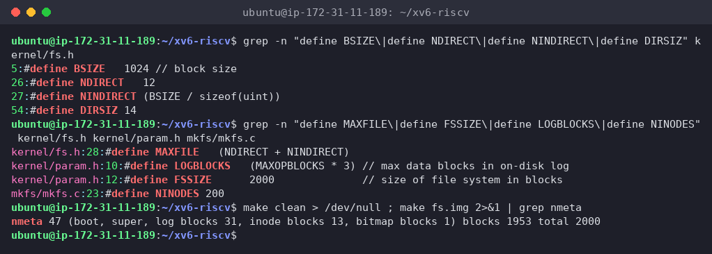
*Figure 3.1 – The constants in fs.h and the disk layout printed by mkfs*

```text
$ mkdir averyveryverylongname
$ ls
```

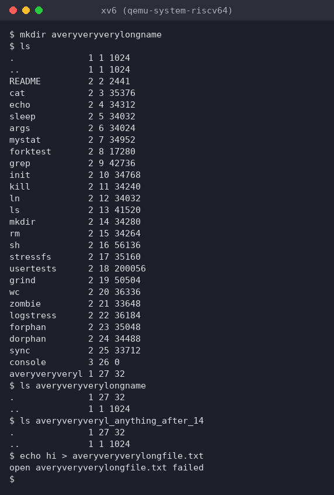
*Figure 3.2 – A name longer than 14 characters is cut to DIRSIZ*

**(1) What does ls show for `averyveryverylongname`, and which constant explains it?**

`averyveryveryl 1 27 32`: the name was cut to its first **14** characters, because of **`DIRSIZ 14`**, the size of `name` in `struct dirent`. The name is silently truncated, with no error. I tried two more things:

- `ls averyveryveryl_anything_after_14` also listed the directory. When looking up a path, xv6 compares only the first 14 characters (`namecmp` uses `strncmp(s, t, DIRSIZ)`), so every name with the same first 14 characters means the same file.
- `echo hi > averyveryverylongfile.txt` failed: `open averyveryverylongfile.txt failed`. The new name also truncates to `averyveryveryl`, which is the existing *directory*, and a directory can't be opened for writing.

**(2) The largest file xv6 can hold**

- block size `BSIZE` = 1024 bytes
- direct blocks: `NDIRECT` = 12
- one indirect block full of 4-byte block numbers: `NINDIRECT` = `BSIZE / sizeof(uint)` = 1024 / 4 = **256** blocks

```text
MAXFILE = NDIRECT + NINDIRECT = 12 + 256 = 268 blocks
max size = 268 × 1024 = 274 432 bytes  =  268 KiB  (≈ 0.26 MiB)
```

(`kernel/fs.h` has `#define MAXFILE (NDIRECT + NINDIRECT)`.) The 12 direct blocks alone only cover 12 KiB, and the indirect block is what makes bigger files possible. The real 6.1810 "big files" lab adds a doubly-indirect block to go past this limit.

**(3) The nmeta line: total blocks, and how many for the log, the inodes and the data**

`nmeta 47 (boot, super, log blocks 31, inode blocks 13, bitmap blocks 1) blocks 1953 total 2000`

| Region | Blocks | Why |
|---|---|---|
| boot | 1 | block 0, unused by xv6 |
| superblock | 1 | sizes and start of each region (magic `0x10203040`) |
| log | **31** | `LOGBLOCKS` = 30 data blocks + 1 header block, used for the journal |
| inodes | **13** | 200 inodes (`NINODES`) × 64 bytes = 12.5 blocks → 13 (16 inodes per block) |
| free bitmap | 1 | 1 bit per block, 8192 bits per block, enough for 2000 |
| **data** | **1953** | everything else: file contents and directories |
| **total** | **2000** | `FSSIZE 2000` in `kernel/param.h` = 2000 × 1 KiB ≈ 2 MB disk |

1 + 1 + 31 + 13 + 1 = 47 metadata blocks, and 47 + 1953 = 2000.

**Interesting output**

In my first try of this part I ran `cat averyveryverylo`, a directory, so `cat` printed its raw 16-byte entries. The terminal then swallowed the next prompt and the first letter of my next command. I decoded the directory from `fs.img` to see why: the first entry starts with bytes **`1b 00`**, the inode number 27 in little-endian, and `0x1b` is the ASCII **ESC** character, so the terminal took the directory's contents as the start of an escape code. xv6 was fine (`echo ok` worked right after). Because of that I retook Figure 3.2 on a clean disk without the `cat`.

## Part 4. Write find

`user/find.c` is based on `user/ls.c`: open the path, `fstat` it, and if it's a directory read `struct dirent`s one by one, build `path/name` in a buffer, and recurse.

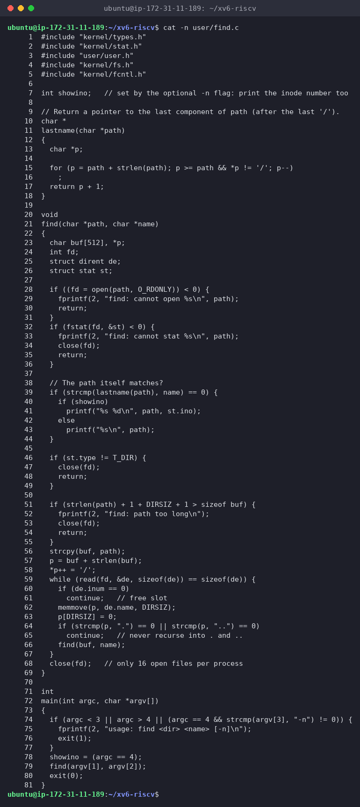
*Figure 4.1 – find.c*

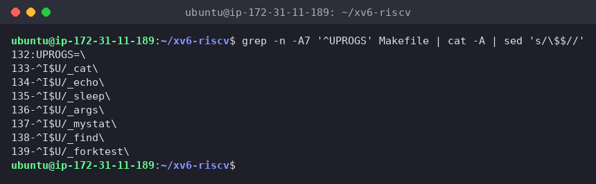
*Figure 4.2 – UPROGS with mystat and find*

```c
#include "kernel/types.h"
#include "kernel/stat.h"
#include "user/user.h"
#include "kernel/fs.h"
#include "kernel/fcntl.h"

int showino;   // set by the optional -n flag: print the inode number too

// Return a pointer to the last component of path (after the last '/').
char *
lastname(char *path)
{
  char *p;

  for (p = path + strlen(path); p >= path && *p != '/'; p--)
    ;
  return p + 1;
}

void
find(char *path, char *name)
{
  char buf[512], *p;
  int fd;
  struct dirent de;
  struct stat st;

  if ((fd = open(path, O_RDONLY)) < 0) {
    fprintf(2, "find: cannot open %s\n", path);
    return;
  }
  if (fstat(fd, &st) < 0) {
    fprintf(2, "find: cannot stat %s\n", path);
    close(fd);
    return;
  }

  // The path itself matches?
  if (strcmp(lastname(path), name) == 0) {
    if (showino)
      printf("%s %d\n", path, st.ino);
    else
      printf("%s\n", path);
  }

  if (st.type != T_DIR) {
    close(fd);
    return;
  }

  if (strlen(path) + 1 + DIRSIZ + 1 > sizeof buf) {
    fprintf(2, "find: path too long\n");
    close(fd);
    return;
  }
  strcpy(buf, path);
  p = buf + strlen(buf);
  *p++ = '/';
  while (read(fd, &de, sizeof(de)) == sizeof(de)) {
    if (de.inum == 0)
      continue;   // free slot
    memmove(p, de.name, DIRSIZ);
    p[DIRSIZ] = 0;
    if (strcmp(p, ".") == 0 || strcmp(p, "..") == 0)
      continue;   // never recurse into . and ..
    find(buf, name);
  }
  close(fd);   // only 16 open files per process
}

int
main(int argc, char *argv[])
{
  if (argc < 3 || argc > 4 || (argc == 4 && strcmp(argv[3], "-n") != 0)) {
    fprintf(2, "usage: find <dir> <name> [-n]\n");
    exit(1);
  }
  showino = (argc == 4);
  find(argv[1], argv[2]);
  exit(0);
}
```

How it follows the lab's rules:

- **match on the last component:** `lastname()` returns what comes after the last `/`, compared with `strcmp`. A path is checked before deciding whether to descend, so `find a b` prints the *directory* `a/b`.
- **free slots:** entries with `inum == 0` are skipped (that's what `rm` leaves behind in a directory).
- **no infinite loop:** `.` and `..` are never recursed into. Without this, `find .` would follow `.` → `.` → … forever.
- **file descriptors:** every directory opened is closed before returning, including the error paths. Each recursion level holds one fd while its children run, so the depth is bounded by the 16-fd limit, and the full path by the 512-byte buffer. Each level also keeps a 512-byte `buf` on the stack, and the xv6 user stack is a single page (`USERSTACK 1`), so very deep trees would also hit the stack. For trees like the ones in this lab it's fine.
- `memmove` + `p[DIRSIZ] = 0` because a 14-character name in a `dirent` has **no** terminating zero (`__attribute__((nonstring))`).

Test on a fresh disk (`make clean ; make qemu`):

```text
$ mkdir a
$ mkdir a/b
$ echo x > a/b/r2
$ echo y > a/r2
$ ln cat r2
$ find . r2
$ find a b
```

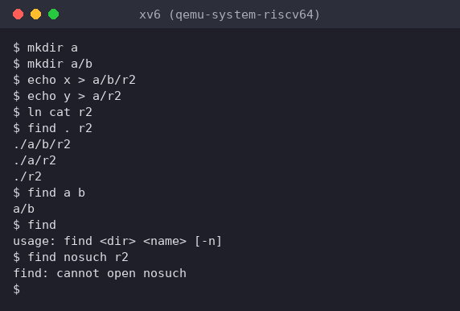
*Figure 4.3 – find on the lab's test tree, plus usage and error cases*

The output matches the lab exactly:

```text
$ find . r2
./a/b/r2
./a/r2
./r2
$ find a b
a/b
```

I also checked the error handling: `find` with no arguments prints `usage: find <dir> <name> [-n]`, and `find nosuch r2` prints `find: cannot open nosuch`.

### Stretch: `-n` prints the inode number

The optional third argument `-n` is already in the code above (`showino`):

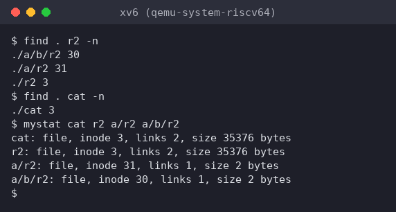
*Figure 4.4 – find . r2 -n, and mystat on the four names*

```text
$ find . r2 -n
./a/b/r2 30
./a/r2 31
./r2 3
$ find . cat -n
./cat 3
```

**Which of the three r2 files are the same file as cat?** Only **`./r2`**: it has inode **3**, the same as `./cat`, because `ln cat r2` made it a second name for the `cat` program. `mystat` confirms it: `cat` and `r2` both show `inode 3, links 2, size 35376 bytes`. `./a/r2` (inode 31) and `./a/b/r2` (inode 30) are separate 2-byte files created by `echo`, with only 1 link each. Same name, different files; different names, same file. Only the inode number tells which is which.

## Wrap-up

xv6 shows the same file-system ideas as ext4 in a few hundred lines. A file is an on-disk **inode** (type, device numbers, link count, size, 12 direct + 1 indirect block addresses) and nothing more: no owner, permissions, times or symlinks. A directory is just a file of 16-byte entries (2-byte inode number + 14-byte name), which I could read byte by byte inside `fs.img`. That explains what I measured: names are cut at `DIRSIZ = 14`, a file can be at most (12 + 256) × 1 KiB = 268 KiB, and the 2000-block disk is 47 blocks of metadata (boot, superblock, 31-block log, 13 inode blocks, bitmap) plus 1953 blocks of data. With `mystat` I watched `ln` raise the link count of inode 2 to 2 and `rm` lower it back to 1 without touching the data. In the kernel, `sys_unlink` only does `ip->nlink--`, and the blocks are freed later in `iput()`, once the count is 0 and the inode is no longer in use. Writing `find` showed how a recursive tree walk is built from the same calls `ls` uses (`open`, `fstat`, `read` of dirents, `close`), and the `-n` stretch showed with inode numbers which `r2` was really `cat`.
